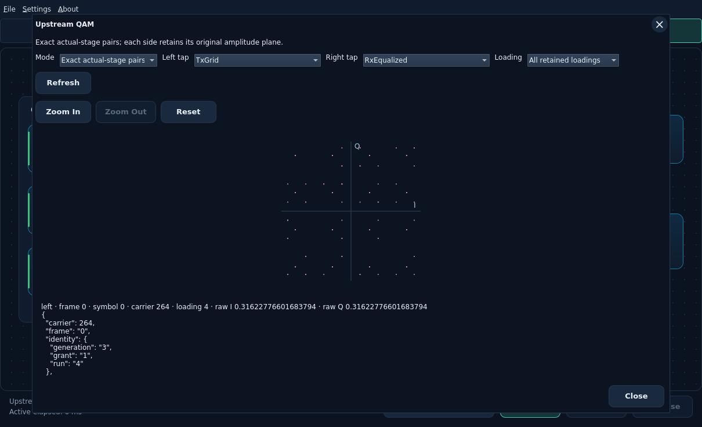
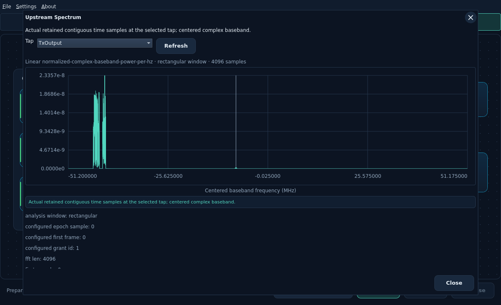
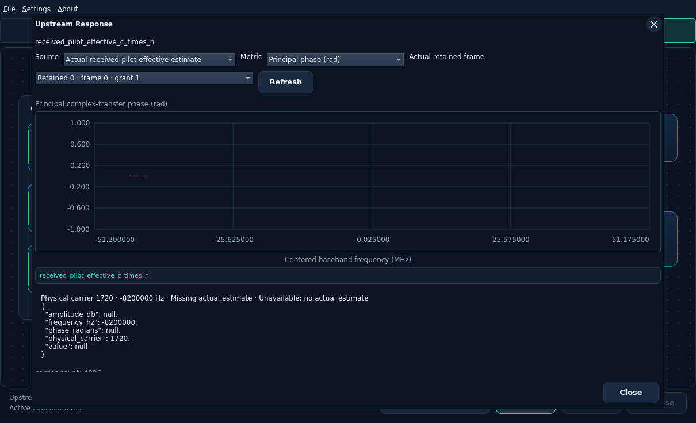
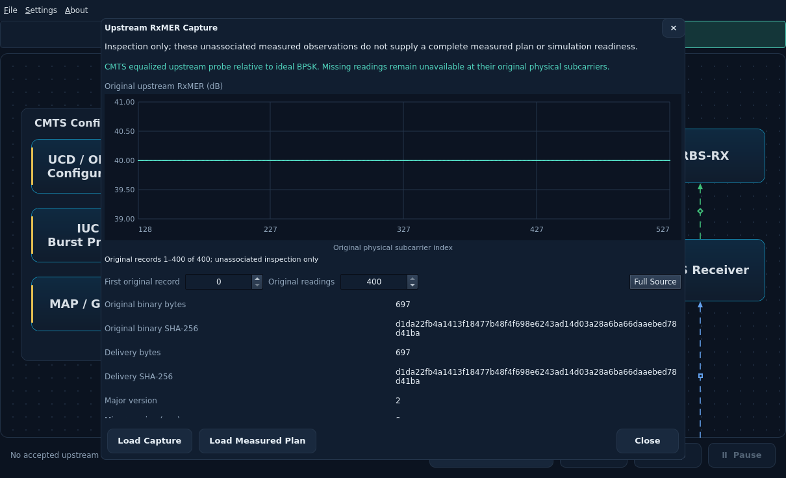
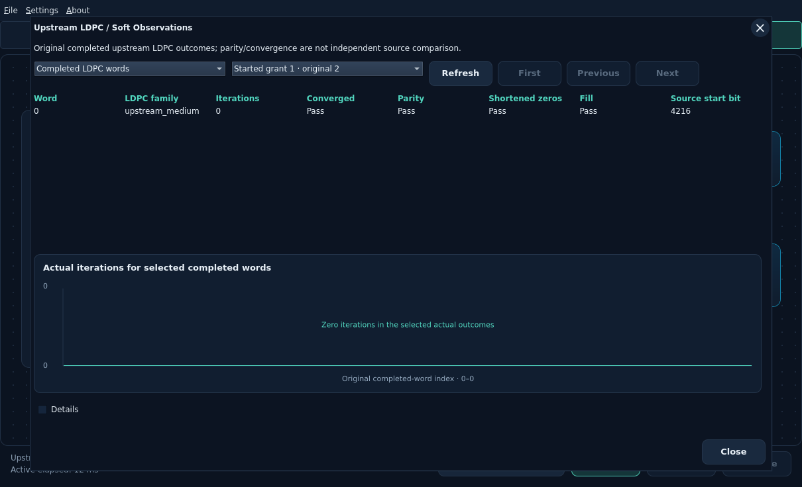
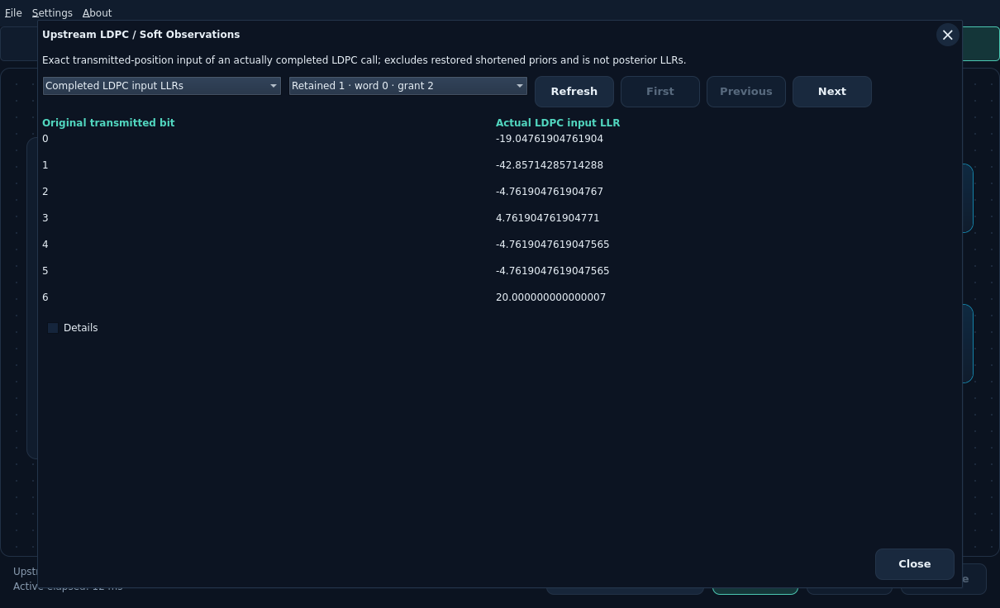

# Upstream scientific instruments

These windows read accepted native Rust configuration or actual retained run
observations. Opening, selecting or navigating a view does not run a simulation,
advance its source or change configuration. Run controls and settings remain
independent for the two directions. Missing observations are shown as unavailable.

## QAM

Open **CM Transmitter → QAM** after a run. Select an actual retained stage and
loading, then **Refresh**. The choices come from the report, including known
pilots and complementary cells; they are not a modem capability catalog.

- **Actual raw I/Q** shows original values at the selected stage.
- **Backend unit reference** shows the backend's compatible normalization and
  labelled canonical reference points. Raw observations and normalization divisors
  remain in the selected point details.
- **Exact actual-stage pairs** matches observations by their original identities,
  frame, symbol and physical carrier. Each side keeps its own amplitude plane;
  pairing does not apply a channel correction.

Zoom, drag and Reset change only screen geometry. Select a point to inspect its
original value, role, loading and lossless identities. References and actual
points share the same screen transform. Copy limits and retained coverage remain
separate from the number of transmitted or recovered bits.

## Spectrum

Open **CM Transmitter → Spectrum**. Choose a retained time-domain tap and Refresh.
The backend calculates the centered complex-baseband PSD from a complete
contiguous retained window, using the report's numerology. Metadata states the
FFT length, sample rate, original first sample, window and units.

Upstream uses **linear normalized complex-baseband power per Hz**. It does not
inherit downstream electrical calibration or PLC bands. Scroll, drag or use the
chart keyboard navigation to request original frequency-bin windows. Selected
readouts retain the original frequency and power values.

A configured tap can lack enough retained samples, especially in a partial run.
That state stays unavailable. To retain additional supported taps or samples,
load a configuration with explicit `retained_taps` and `retained_points` settings;
viewing cannot reconstruct discarded history.

## Response and periodic impulse

Open **Channel Simulator**, **CM Pre-Eq** or **CMTS Receiver**, then
**Inspect Response**. This closes the configuration draft without applying it.
Choose a source and metric, then Refresh:

| Source | Meaning |
| --- | --- |
| Configured physical H | The admitted deterministic propagation response. |
| Configured transmit correction C | CM correction before propagation. |
| Configured deterministic C×H | The admitted correction/propagation combination. |
| Actual received-pilot effective estimate | A retained receiver estimate from actual received observations. |

Amplitude dB, principal phase and configured periodic impulse values come from
Rust. The configured inverse uses a complete backend period before selecting a
sample viewport; it is not a cropped-spectrum inverse or a claim about causal
echoes. The actual received estimate has no public impulse operation, so that
combination is unavailable. Configured H never substitutes for a missing estimate.

New native sessions retain at most one complete actual estimate frame through
the existing bounded observation policy. Frame selection preserves the original
report inventory and identities. Missing and exact-zero estimates remain distinct;
undefined logarithms or phases produce gaps rather than a finite floor. Inspect a
point for its original complex value and metadata. Configuration, active work or
stale context can make a view unavailable without replacing its previous data.

## Original RxMER capture plot

Open **RxMER → View Capture**, then Load Capture. The shared measurement drawing
shows the original physical-carrier indices and decoded dB readings, including
null gaps. Hover to inspect an original reading. Zoom, select a range, or use
**First original record**, **Original readings** and **Full Source** to request a
bounded viewport. A plot contains at most 4096 original readings; the source
inspector table independently displays at most 64 records.

The original binary and delivered-file hashes, byte counts and metadata remain
visible. This view is unassociated inspection; plotting does not apply RxMER,
select a profile or admit an impairment combination. CM Pre-Eq coefficients remain
separate transmit-correction evidence. Use a complete measured plan to configure
an explicitly supported experiment.

## LDPC and soft observations

After a run, open **CMTS Receiver → Inspect FEC / LLR**, or use the same action
from **PRBS-RX**. The receiver action closes its configuration draft without
applying it. Select an observation plane:

- **Completed LDPC words** shows the actual selected started grant's completed
  words, upstream code family, iterations, convergence, parity, shortened-zero
  consistency, fill consistency and original source-bit start. The chart shows
  actual iterations for that page; it is not a whole-run iteration histogram.
  Upstream data has no BCH stage or per-word independent source-error count.
- **Raw / derandomized cell LLRs** shows actual MSB-first bit metrics with their
  original retained-cell, frame, symbol and physical-carrier positions. Raw
  demapper and PHY-derandomized values are separate columns.
- **Completed LDPC input LLRs** shows original transmitted-bit indices and the
  exact input to an actually completed decoder call. These are not posterior
  metrics or restored shortened priors. Positive natural-log P(0)/P(1) favors zero.

Use the supplied started-grant or retained-word choices and **Next**, **Previous**
and **First** for original-coordinate pages. The initial views contain one
completed word, up to eight computed cells or 64 actual word-input values.
A missing history stays unavailable; changing views never replays a receiver or
advances its source. Table rows are virtualized and scroll independently.
**Details** reveals original identities, copy/retention counts, dimensions,
reference planes and independent source-coverage metrics below the instruments.

New native sessions retain at most 64 computed cells and two complete LDPC-input
words under a separate finite scalar budget. These observation choices do not
change source, receiver, decoding or recovery behavior. Earlier reports without
soft retention remain unavailable, and a partial report can contain computed
cells without any completed word.

PRBS-RX shows the original continuous PRBS15 seed, lifecycle, generated/compared/
unverified meaningful bits, bit errors and optional BER. BER uses the independently
compared meaningful bits as its denominator. No compared bits means unavailable;
exact zero is `0`, and nonzero BER uses scientific notation. Convergence, parity,
fill and ordinary lifecycle completion do not independently prove recovery.
Cancelled work retains its original completed observations and incomplete coverage.

The [receiver soft-observation contract](soft-observations.md) and
[recovery guide](recovery.md) explain the backend's supported planes and limits.
