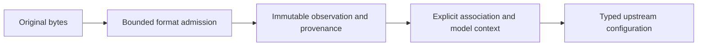

# Upstream measurement admission

[Upstream guide](README.md) · [Synthetic fixtures](../../../examples/measurements/upstream/README.md)

The native `pnm-input::upstream` adapter owns raw upstream observations. It retains
original bytes and SHA-256 fingerprints, exact source identities, grids, timestamps
and missing readings. Decoding does not start a simulation or choose associations.

Each typed capture also supports `from_source_json` and `to_source_json` for a
lossless source envelope. This transport includes the original binary bytes, their
exact byte count and SHA-256. It is separate from the existing inspection-only
`to_json`, which cannot be imported as an original capture. The source format is
`merlin.upstream.capture-source`, schema 1, with an exact `capture_kind` of `ucd`,
`rxmer` or `pre_eq`. The typed importer checks the envelope before invoking the
same binary decoder. Text is bounded to 1 MiB; the binary family limits remain
unchanged. Duplicate/unknown fields, wrong identities and inconsistent counts or
hashes fail explicitly. Loading still supplies no association or executable plan.

The returned snapshot owns decoded original **binary** bytes. Applications keep
an imported JSON file's delivery bytes and delivery hash separately when source
formatting is evidence. Neither representation replaces the other.

UCD inspection accepts management envelopes starting at DA and excluding CRC.
Multipart reassembly requires a complete ordered set with consistent identity;
its canonical assembled view is derived data. Callers retain each physical
fragment. Semantic projection additionally requires explicit PHY bandwidth.

CCAP RxMER admission supports the documented major2 profile, quarter-dB readings
and `0xff` missing positions. Opaque flags, vendor revisions and identifier padding
remain inspectable. Inspection alone does not establish a CM/channel/time cohort
or a residual-noise model.

Pre-Eq admission distinguishes applied s2.13 banks from last-update s1.14 values.
For minor zero it delegates to the exact pinned PNM decoder; the approved opaque
minor profile uses that decoder's fixed-point kernel after bounded envelope
checks. No header bytes are rewritten. Update files still require external
operation, application status, corresponding probe and base-bank context.

Measured correction C is distinct from physical channel H and receive noise.
Whole-plan association and playback now pass local Rust acceptance.
`MeasuredExperiment::from_json` admits bounded plan JSON; `admit` prepares the
core-owned input for `Simulation::configure_measured`. Loading is idle and failed
admission preserves the previous session. Native Python and CLI exposure follow
the public API gates. Existing downstream capture
admission keeps its established contracts.

Plans require explicit CM/CMTS identity, CCAP-interface mapping when RxMER is used,
source-time bounds, exact UCD/grid compatibility and source interpretation evidence.
RxMER selection, equal-weight power average, hold or interpolation is explicit;
source epochs are retained separately from replay offsets. No frequency resampling
or missing-bin invention occurs. Updates require application status and their
corresponding probe/base; an older base can remain valid when that exact probe
observed it. Entire schedules are checked before a run begins.

The supported measured-RxMER model uses unity physical H and unity effective C
throughout, without added timing/noise impairments. Pre-Eq-only input does not need
invented CCAP or RxMER metadata. Original files, raw plan JSON and hashes survive
completed/cancelled reports; normalized effective banks remain derived values.
