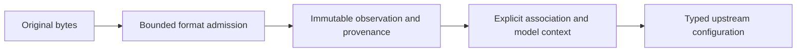

# Upstream measurement admission

[Upstream guide](README.md) · [Synthetic fixtures](../../../examples/measurements/upstream/README.md)

The native `pnm-input::upstream` adapter owns raw upstream observations. It retains
original bytes and SHA-256 fingerprints, exact source identities, grids, timestamps
and missing readings. Decoding does not start a simulation or choose associations.

UCD inspection accepts management envelopes starting at DA and excluding CRC.
Multipart reassembly requires a complete ordered set with consistent identity;
its canonical assembled view is derived data. Callers retain each physical
fragment. Semantic projection additionally requires explicit PHY bandwidth.

CCAP RxMER admission supports the documented major2 profile, quarter-dB readings
and `0xff` missing positions. Opaque flags, vendor revisions and identifier padding
remain inspectable. Inspection alone does not establish a CM/channel/time cohort
or a residual-noise model.

Pre-Eq admission distinguishes applied s2.13 banks from last-update s1.14 values.
For minor zero it delegates to the exact pinned PNM decoder; the approved opaque
minor profile uses that decoder's fixed-point kernel after bounded envelope
checks. No header bytes are rewritten. Update files still require external
operation, application status, corresponding probe and base-bank context.

Measured correction C is distinct from physical channel H and receive noise.
Whole-plan association and playback remain a separate acceptance gate; native
Python and CLI exposure follow the public API gates. Existing downstream capture
admission keeps its established contracts.
