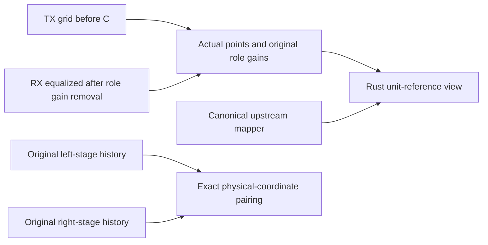

# Upstream QAM references and actual stage pairs

[Upstream models](README.md) · [Receiver](receiver.md) ·
[Received response](receiver-estimates.md)

Raw QAM preserves actual stage I/Q and original run, grant, frame, symbol,
carrier, role and loading. The normalized view adds backend-derived unit-reference
values and canonical upstream source labels. It never replaces an observation
with its nearest ideal point.



`qam_constellation(...)` supports TX grid before C and actual equalized RX.
TX normalization removes its original recorded ResourcePlan role gain; receiver
values are already at unit reference. Samples pair each unchanged raw point with
its normalized value and divisor. References use the upstream mapper and MSB-first
labels. Known pilots retain zero payload loading with BPSK reference geometry.

Pre-Eq output and raw RX FFT have different physical planes. Unit-reference
overlays reject those selections rather than guessing stationary C/H or borrowing
configured truth. Their actual raw `qam(...)` data remains available. Normalized
queries report the whole retained matching available count and display capping;
this does not establish full receive coverage.

With an existing report and the relevant taps retained:

```rust,ignore
use merlin::upstream::{QamConstellationRequest, QamPairRequest};

let view = report.qam_constellation(QamConstellationRequest::default())?;
let pairs = report.qam_pairing(QamPairRequest::default())?;
```

```python
view = report.qam_constellation()
pairs = report.qam_pairing()
pilots = report.qam_constellation("TxGrid", loading=0)
```

Pairing matches exact run/generation/grant/frame/symbol/physical-carrier
coordinates. It returns unchanged points in left retention order, whole retained
selected/matched/unpaired counts and capping. Each stage keeps its own amplitude
plane. There is no source replay, interpolation or inferred waveform alignment.
These counts are separate from FEC/source denominators. Empty or partial retained
histories can have no pairs without claiming successful recovery.

Select both taps in ExperimentOptions before running. Default experiments retain
TX waveform output and equalized RX data, rather than every scientific tap.
Unretained stages are unavailable. Actual-point, reference and pair-copy policies
each currently have a 4096 ceiling, with separate owners and purposes. A reference
budget must hold the complete constellation; it never truncates labels or changes
modulation. Invalid limits and unavailable/unsupported selections reject before
copying. Owned results survive session/report disposal and later runs. Python
releases the GIL while Rust performs projection, association and serialization.

[Actual received-pilot estimates](receiver-estimates.md) also provide backend
amplitude dB and principal phase radians. Missing and exact-zero estimates have
no logarithmic or phase reading, without a display floor or zero-phase fiction.
Configured transfers and periodic impulses remain separate [diagnostics](response.md).

See the [Rust-process example](../../../crates/ofdma/examples/upstream_qam_views.rs)
and [implementation record](../../development/features/unified-qt-workbench/design.md#uiu-api-04-constellation-pairing-and-received-response-display-unit).
Qt adoption remains separate.
