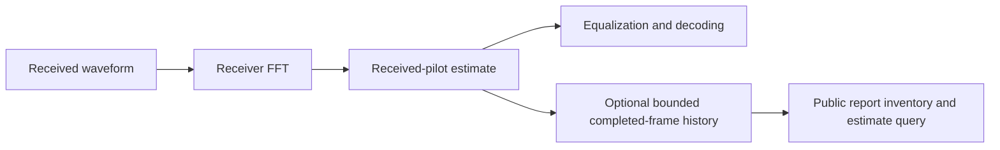

# Actual upstream received-pilot estimates

[Upstream models](README.md) · [Receiver](receiver.md) ·
[Configured response](response.md)

The normal receiver estimates effective C×H from received known pilots. Optional
observation retains that already calculated vector after each completed frame.
It does not rerun estimation or supply the receiver with configured C or H.



Retention is disabled by default and separate from sample/QAM tap budgets.
Enable it before running. Frame and Cartesian scalar budgets span all grants;
each complete optional complex FFT bin reserves two scalar slots, including
unavailable bins. Current application ceilings are eight frames and 262144
scalar slots. A policy must hold at least one complete estimate for the accepted
numerology. Rejected replacement preserves configuration, generation and policy.

Rust callers use `merlin::upstream`:

```rust,ignore
use merlin::upstream::{ReceiverEstimateRequest, ReceiverObservationPolicy};

const RETAINED_FRAME_BUDGET: usize = 3;
const RETENTION_SCALAR_BUDGET: usize = 262_144;

// simulation is an existing configured upstream Simulation.
simulation.set_receiver_observation_policy(ReceiverObservationPolicy::new(
    RETAINED_FRAME_BUDGET,
    RETENTION_SCALAR_BUDGET,
)?)?;
let report = simulation.run()?;
let inventory = report.receiver_observations();
if !inventory.frames.is_empty() {
    let estimate = report.receiver_estimate(ReceiverEstimateRequest::default())?;
}
```

Python uses the same engine through the one native distribution:

```python
from merlin.upstream import ReceiverObservationPolicy

RETAINED_FRAME_BUDGET = 3
RETENTION_SCALAR_BUDGET = 262144

simulation.set_receiver_observation_policy(
    ReceiverObservationPolicy(RETAINED_FRAME_BUDGET, RETENTION_SCALAR_BUDGET)
)
report = simulation.run()
inventory = report.receiver_observations()
if inventory["frames"]:
    estimate = report.receiver_estimate()
```

Inventory entries preserve original run, configuration generation, grant and
physical frame. Select a retained index from that inventory. A query returns an
owned carrier window with original FFT indices, centered baseband frequencies
in hertz, estimator and dimensionless complex transfer. Zero carrier count means
the remaining FFT; copied points have an independent 4096-point application cap.
Queries and later session changes cannot modify an existing report.

The Rust query also supplies amplitude dB and principal phase radians from each
actual optional estimate, using the shared transfer-projection owner. Missing
or exact-zero values have no logarithmic or phase reading and no arbitrary floor.
See [QAM and response display contracts](qam-views.md).

Unknown or unused carriers remain unavailable (`None`/JSON null). Actual zero
estimates remain complex zeros. Deep-null correction admission stays with the
receiver. Complete frames with missing observations can have entirely unavailable
estimates. No configured response fills holes, and no full-band impulse is
inferred from incomplete spectral support.

Cancellation keeps previously completed frames; an interrupted partial frame
claims no complete estimate. Inventory distinguishes retained frames from complete
frames omitted after budget exhaustion. Disabled counts describe observation
availability and do not claim the receiver did no work. Default report JSON omits
the optional receiver history field.

See the [separate Rust-process example](../../../crates/ofdma/examples/upstream_receiver_estimates.rs)
and [implementation record](../../development/features/unified-qt-workbench/design.md#uiu-api-04-received-pilot-estimate-retention-unit).
[Actual soft-metric retention](soft-observations.md) has separate policies and
scoped acceptance. Qt viewer integration remains a later task.
