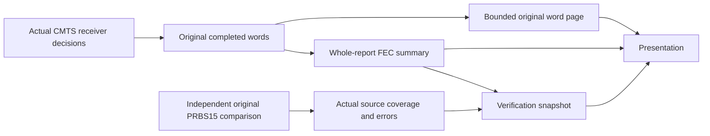

# Upstream recovery and decoder views

The Basic Rust API exposes typed recovery views on an owned upstream BatchReport.
The Basic Python API returns the same data as owned dictionaries. These passive
operations read completed science; they do not start another source, decoder or
simulation. A UI can display bounded details without exporting an entire report
or calculating scientific totals in its adapter.



`verification()` describes actual generated, compared and unverified source
coverage, original-source bit errors, optional BER, lifecycle and complete
recovery. It retains the continuous PRBS15 source seed, independently of the PHY
randomizer seed. The [source contract](configuration.md) owns the recurrence and
bit order. Planned source bits exclude fill and parity. When no decisions were
compared, BER remains unavailable. Completed execution can still have failed
recovery; a cancelled run can retain a valid completed prefix.

`fec_summary()` reports planned, completed and pending words. Convergence, parity,
shortened-zero consistency and information-fill consistency remain independent
flags. Actual decoder iterations and hard-decision changes come from completed
outcomes. No completed words means the maximum iteration count is absent. Neither
a parity pass nor convergence proves agreement with the original source.
Pending words have no invented decoder outcome and are not counted as failures.

`fec_words(...)` selects one original started-grant index and a completed-word
ordinal range. Positions are separate from grant/profile identities. Each result
preserves the actual run/configuration/grant association, source-bit start,
encoded-grant offset, upstream short/medium/long code identity, normative mother
dimensions, shortening and transmitted count. Payload, retained information and
full mother decisions are exact copies of the original outcome, including failed
decisions. The upstream data path has no downstream BCH stage.

For an actual completed or partial Python report:

```python
verification = report.verification()
summary = report.fec_summary()
page = report.fec_words()
```

The default page contains at most one word. A caller can request up to 32 words,
with a separate ceiling of 262144 copied decision bits. The bit budget counts
every copied mother, information and payload vector, including repeated
representations of the same logical data. Rust checks the complete selected
page before allocating it. These are application policies, independent of PHY
code dimensions, decoder iterations and simulation-retention limits.

`next_word` gives the next completed-word ordinal when another page exists.
Starting exactly at the actual completed end returns an empty page. A grant that
never started has no page; a started grant without completed words can have an
empty page. Original full-grant completed/pending totals and whole-report scalar
summaries remain independent of page size. Invalid positions, exhausted copy
budgets and inconsistent report metadata return explicit errors.

Rust returns owned typed snapshots/pages. Python releases the GIL during Rust
query/serialization and returns ordinary copied dictionaries. Editing a returned
Python list changes no report or later query. Results survive later runs and
session/report disposal. Neither language reconstructs missing observations.

Actual QAM/PSD remain the existing [session operations](session.md). Received
pilot-estimate, response/impulse and LLR instrumentation are separate work and
are not supplied by these decoded-decision projections.
