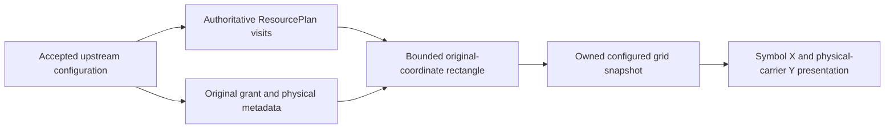

# Configured upstream resource grid

The Basic Rust API and Basic Python API inspect the accepted CM transmit resource
plan while the session is idle. The operation provides the original allocation
and pilot positions for a viewer; it does not generate a waveform or a receiver
observation. Qt and Python do not reconstruct pilot patterns or interleaving.



Rust uses `Simulation::resource_grid(ResourceGridRequest)` and receives an owned
ResourceGridSnapshot. Python uses `simulation.resource_grid(...)` and receives
an importable `merlin.upstream.ResourceGridSnapshot`; its `to_json()` exports the
same Rust data. The export identifies `merlin.upstream.resource_grid`, schema 1,
independently of DOCSIS and application versions. No file is written by the API.

The default inspects the first symbol of the first configured base-grant frame
over the full original FFT carrier span. Select a relative frame index and an
original symbol/carrier viewport. A zero symbol or carrier count selects the
remaining corresponding extent. Work is limited to 16384 cells; large grids use
multiple viewports. Validate the complete requested rectangle before copying.
JSON export has a separate eight-MiB transport ceiling.

For an already configured Python session:

```python
import json

snapshot = simulation.resource_grid()
view = json.loads(snapshot.to_json())
grid = view["grid"]
```

Cells are ordered by increasing frame symbol and physical carrier. Their roles
come from the actual accepted plan and original configuration:

- **Data** carries ordinary loaded payload.
- **Complementary** carries data at the existing lower loading.
- **Known pilot** carries the configured known reference and consumes no coded bits.
- **Zero loaded** is a selected zero-valued minislot location without a resource visit.
- **Excluded** is an explicit original physical exclusion.
- **Unallocated** has no selected resource; configured but unselected minislots
  can retain their metadata without becoming pilots or payload.

Physical holes remain in place. A role is never inferred from whether an I/Q
sample is zero. Each cell preserves original minislot index/pattern/loading,
grant-selection flag, and frame/grant symbol coordinates. Resource visits also
retain their original joint-interleaver index, actual cell loading, planned
pilot/complementary amplitude gain and frame/grant coded-bit offsets. Locations
without visits have no invented gain or bit position. The planned gain precedes
CM Pre-Eq and says nothing about physical H or a received C×H estimate.

The snapshot preserves original grant identity/epoch/first frame, selected profile
and IUC, FFT size, sample clock, carrier spacing, prefix, roll-off and stride.
It does not infer an absolute RF frequency origin from the physical carrier index.
Relative frame indices and absolute frame identities remain distinct. Timing uses
the admitted sample-clock origin:

\[
t_\mathrm{prefix}=t_\mathrm{grant}+
(i_\mathrm{frame}K+i_\mathrm{symbol})(N+C).
\]

The useful window starts C sample ticks later. An arbitrary absolute first-frame
ID is not multiplied by stride to invent a sample origin. Final roll-off support
does not change the admitted prefix-to-prefix stride.

Role counts describe the selected rectangle. Full frame/grant coded capacity and
the original complete visit count come from the full ResourcePlan, independently
of zoom. `transmission_planned` comes from the existing grant selector; allocation
cells alone do not prove that a payload waveform will be emitted or recovered.
The snapshot covers the configured base grant, rather than fabricating later
batch-run identities or observations.

Queries preserve the accepted configuration generation and source/noise state.
Returned snapshots remain usable after reconfiguration or session disposal.
Missing settings, invalid windows and exhausted budgets fail explicitly. Python
releases the GIL during preparation/export and uses the existing Busy guard while
a run owns the session. Actual QAM, spectrum and recovery remain separate
[session/report operations](session.md).

The projection reuses the accepted upstream pilot/resource owner and its pinned
PHY I20 section 7.4.16 evidence. It introduces no additional pilot pattern or
operating mode. The Qt viewer is a separate delivery task; this page describes
the implemented backend observation.
