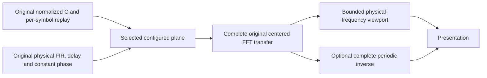

# Configured upstream response diagnostics

The Basic Rust API and Basic Python API inspect the admitted CM correction C,
deterministic physical channel H and their configured composite C×H. These are
diagnostics of accepted settings. They are separate from measured captures,
actual received samples and the normal receiver's pilot-estimated response.
Querying them starts no waveform, source, channel stream, receiver or RNG.



Rust uses `Simulation::configured_response(ConfiguredResponseRequest)` for the
accepted idle configuration, or the same operation on an owned BatchReport for
its frozen original settings. Python exposes `configured_response(...)` on both
objects and returns an independent dictionary. The default source is
`physical_channel`; the other sources are `cm_pre_eq` and `composite`.

C comes from the accepted complete PreEqBank, or PreEqPlayback at the original
base-grant symbol. Normalization and updates remain in those existing Rust
owners. Original excluded zeros and unused nonexcluded coefficients are
preserved. `pre_eq_generation` identifies the selected bank's actual generation;
it is separate from replay event and probe IDs. C is a transmit correction,
rather than an inferred inverse of a measured H.

H comes from the configured causal FIR taps, integer delay and constant phase.
The calculation uses the shared centered unitary transform:

\[
H[k]=e^{j\phi}e^{-j2\pi f_k d/f_s}\sqrt{N}\,\mathrm{FFT}_{u}(h)[k].
\]

The phase follows the actual channel owner's initial modulo-one-turn convention.
The composite multiplies the selected C by this deterministic H. Sample noise
and admitted RxMER residual impairment are excluded from these transfers; their
configured presence remains explicit metadata. Physical H stays defined on an
excluded signal carrier. C and the composite retain the original excluded zeros.

A nonzero configured frequency offset makes H time varying. Static H/composite
queries then return an explicit unsupported error; the separate C-only query
remains available. Existing measured channel-composition restrictions still apply.
This operation does not infer unknown physical H from a Pre-Eq or RxMER capture.

The frequency viewport preserves original increasing physical FFT indices,
centered baseband Hz, exclusions, complex transfer, amplitude dB and phase in
radians. It supplies no inferred absolute RF origin. An exact zero has no finite
logarithmic or phase reading. No arbitrary display floor replaces missing values.
The default covers the full original FFT. A zero carrier count means remaining
extent; `maximum_points` is a positive frequency-display budget, at most 4096.

For an already configured Python session:

```python
response = simulation.configured_response("physical_channel")
with_impulse = simulation.configured_response("composite", include_impulse=True)
```

The optional impulse uses the complete original transfer before viewport
selection:

\[
h_{\mathrm{periodic}}=\mathrm{IFFT}_{u}(G)/\sqrt{N}.
\]

It contains the whole N-sample period, bounded separately to 4096 samples.
Frequency and impulse budgets serve different purposes even though their current
ceilings match. Original periodic indices, time seconds, complex values and dB
relative to the complete-period peak come from Rust. Zero samples retain absent
logarithmic readings. Zooming the frequency view cannot alter this full inverse.

This is a **periodic impulse diagnostic**. Delays wrap modulo N; the original
configured physical delay remains separate metadata. It is not an unaliased
causal echo or a measured impulse. Finite burst boundaries, prefix/window effects,
inter-symbol interference and noise are not reconstructed by a configured
frequency product. The diagnostic does not establish that a particular finite
waveform experiences ideal circular convolution.

Idle queries preserve configuration generation and reuse the existing Busy guard.
Frozen reports retain the original run/generation when a grant actually started.
A never-started report has no fabricated execution identity. All returned data
is owned; reconfiguration, later runs and object disposal cannot change it.
Python releases the GIL for numerical work and serialization, with the same Rust
validation and errors. Invalid windows, exhausted budgets, nonfinite arithmetic
and unsupported static-H assumptions fail explicitly.

See [channel reference planes](channel.md), [measured inputs](measurements.md)
and [receiver separation](receiver.md). Actual pilot-estimated C×H and soft
instrumentation require their own retained receiver observations; they are not
reconstructed through this configured diagnostic.
