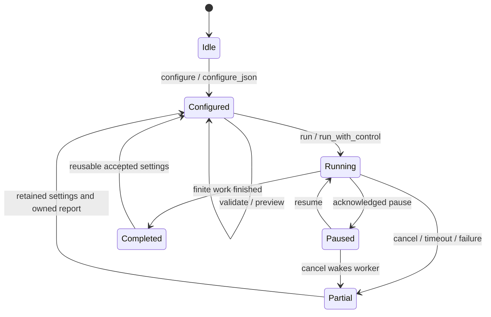

# Bounded upstream simulation session

The Basic Rust API is available through `docsis_ofdma::api::Simulation`.
Construction takes explicit `ExperimentOptions` and remains idle. A session accepts
a typed `ExperimentConfig` or strict schema-1 configuration bytes. Inventory,
validation and preview do not start source generation or consume random state.

`simulation.options()` borrows the actual accepted `ExperimentOptions` in the
Basic Rust API. It includes explicit `set_options` overrides, which need not
match the unchanged source document. This passive getter allocates nothing and
does not advance the source. Clone it to retain an independent snapshot.

The Basic Python API exposes `simulation.options() -> ExperimentOptions` through
`merlin.upstream`. It returns an owned immutable options wrapper that can be
passed to `Simulation(options)` or `set_options(options)` after the original
session changes or is disposed. The existing native guard raises a structured
`Busy` error during execution. Typed `configure(config)` preserves constructor
options; `configure_json(bytes)` accepts the source document's options.

Rejected settings preserve the accepted configuration and options. Rust's exclusive
mutable session borrow serializes configuration/run calls. A separate cloneable
control remains reachable from another thread for cancellation, pause/resume and
small owned progress snapshots. Controls carry run/generation identities; sharing
a busy control across workers rejects. Paused time is excluded from the active
runtime budget after the worker acknowledges its safe boundary.

Each run returns an owned complete or partial report. Generated, emitted, compared
and unverified source coverage remain distinct. Reports keep actual failed decoder
decisions, convergence/parity/known-zero/fill results, iterations, bit errors,
pending tails and not-started grants. Zero compared bits have no BER value.
Successfully finishing a run does not assert successful source recovery.

QAM and spectrum queries inspect retained real stage observations with bounded
coverage. They never rerun science or reconstruct absent history. Configuration
loads retain exact original bytes and hashes separately from resolved JSON.

[Configuration inputs](../../../examples/cli/upstream/README.md) cover both
numerologies, mixed/zero loading and inspection-only controls. See
[local acceptance](../../development/features/ofdma/design.md#session-and-core-acceptance).
The `merlin::upstream` facade and Basic Python API namespaces follow the selected
[namespace design](../../development/features/high-level-api/namespace-design.md)
and its acceptance records. The native [unified workbench](../upstream-workbench.md)
uses the same direction-specific Rust APIs.
