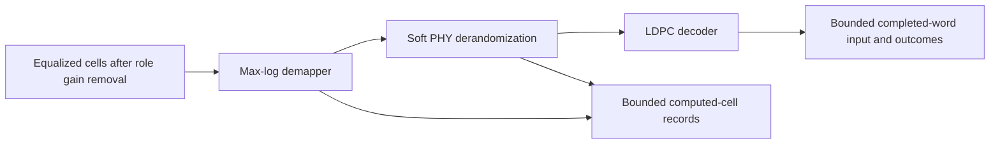

# Actual upstream receiver soft observations

[Upstream models](README.md) · [Receiver](receiver.md) ·
[Decoder and verification results](recovery.md)

Optional soft observation retains the normal receiver's actual intermediate
metrics. It does not rerun a demapper or decoder, infer metrics from final bits,
or change the receiver's confidence assumption.



Cell records contain optional corrected I/Q, original frame/symbol/carrier and
role/loading, original coded-bit offset, declared complex reference variance,
raw demapper metrics and derandomized metrics. Both vectors are MSB-first
natural-log P(0)/P(1), with positive values favoring zero. The clipping magnitude
comes from the same Rust max-log owner used during reception. Known pilots do
not occupy coded positions. Missing cells retain unavailable I/Q and actual
zero-erasure metrics; present zero samples remain distinguishable.

Word records contain the exact transmitted-position vector passed to a completed
LDPC call. They preserve original word ordinal/coded offset and completion frame,
upstream code family and shortening dimensions, actual iterations and independent
convergence/parity/shortened-zero/fill outcomes. Failed completed decisions remain
inspectable. The retained input excludes shortened priors restored inside the
decoder and supplies no posterior LLRs. Source comparison remains the independent
[verification result](recovery.md).

Configure independent opt-in limits before running:

```rust,ignore
use merlin::upstream::{ReceiverObservationPolicy, SoftObservationPolicy};

const RETAINED_CELL_BUDGET: usize = 1024;
const RETAINED_WORD_BUDGET: usize = 16;
const WORD_INPUT_BUDGET: usize = 262_144;

let policy = ReceiverObservationPolicy::default().with_soft_metrics(
    SoftObservationPolicy::new(
        RETAINED_CELL_BUDGET, RETAINED_WORD_BUDGET, WORD_INPUT_BUDGET,
    )?,
);
simulation.set_receiver_observation_policy(policy)?;
let report = simulation.run()?;
let inventory = report.soft_observations();
```

Python mirrors that policy and execution through native Rust:

```python
from merlin.upstream import ReceiverObservationPolicy, SoftObservationPolicy

RETAINED_CELL_BUDGET = 1024
RETAINED_WORD_BUDGET = 16
WORD_INPUT_BUDGET = 262144

policy = ReceiverObservationPolicy().with_soft_metrics(
    SoftObservationPolicy(RETAINED_CELL_BUDGET, RETAINED_WORD_BUDGET, WORD_INPUT_BUDGET)
)
simulation.set_receiver_observation_policy(policy)
report = simulation.run()
inventory = report.soft_observations()
```

Estimate retention is independent: its default can stay disabled for soft-only
observation, or compose soft limits onto an existing estimate policy. Policies
are immutable values. An all-zero soft policy removes soft retention.

Application ceilings are 1024 computed cells, 32 completed words and 262144
word-input scalars across all grants. Each retained cell has two complete vectors
bounded by admitted loading. A word that cannot fit the remaining scalar budget
is omitted completely; a later smaller word can still fit. Retained indices and
original word ordinals are therefore distinct. Default reports retain their
previous shape when observation is disabled.

`soft_observations()` inventories observed/retained/omitted counts and original
word identities. `soft_cells(...)` returns owned pages with independent cell and
raw-plus-derandomized scalar copy budgets; exact end returns empty.
`soft_word(...)` selects an actual retained complete input vector with a separate
finite copy ceiling. Invalid/insufficient query budgets reject before copying.
Queries do no scientific replay and owned results survive session/report disposal.

A computed cell can exist even when cancellation prevents some of its bits from
reaching a completed codec call. Final grant-pad metrics are also computed cells.
Incomplete words have no completed-word snapshot. Cancellation preserves completed
work, and invalid receive transactions preserve earlier accepted observations.
Disabled counts describe observation availability rather than all receiver work.
These observations and the Qt FEC/soft viewer remain separate acceptance stages.

See the [Rust-process example](../../../crates/ofdma/examples/upstream_soft_observations.rs)
and [owner/acceptance record](../../development/features/unified-qt-workbench/design.md#uiu-api-04-actual-receiver-soft-metric-retention-unit).
