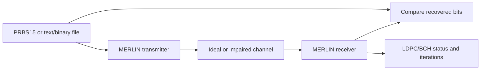

# MERLIN closed-loop validation

MERLIN generates a signal, passes it through the configured channel, receives it
and compares the recovered data against the original source. Another DOCSIS
implementation, CMTS capture or instrument export is not required.

## What the results mean

- **Ideal connection:** transmitted data must be recovered with zero bit errors.
- **Impaired connection:** report actual corrected/failed words, LDPC iterations
  and bit errors. Noise must not be hidden or replaced with expected decisions.
- **Incomplete run:** preserve completed comparisons and identify pending data;
  cancellation is not a successful completed zero-error result.

PRBS15 provides a reproducible source. User files provide exact bytes that can be
compared after recovery; optional PRBS fill and coding padding are counted separately.
RxMER, channel estimation and modulation-profile inputs configure a simulated
experiment. The original source remains the comparison truth.

## QAM and receiver coverage

The PyPNM text resources provide ordered reference points through16K-QAM. For data
orders, row0 corresponds to binary label0, row1 to label1, and so on. The tests
check every data label and its scaling, alongside uniform, mixed and shortened
coding/recovery tests. BPSK/QPSK control mappings have their explicit permutations.

Width/profile tests cover24/90MHz at25kHz with four profile loadings. The acquired
receiver tests separately cover24/90/192MHz at25/50kHz, frequency offsets, reflected
paths and sample perturbations. These are documented test matrices rather than a
claim that every possible combination has been exercised.

**WAVE-RX-05, QAM-04 and QA-05 are complete for the minimum closed-loop engine.**
Qt, Python, native delivery and later PHY features remain separate work.
See [the design](../../development/features/closed-loop-validation/design.md) and
[test evidence](../../development/features/closed-loop-validation/validation.md).
