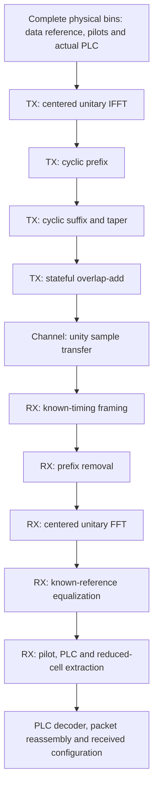

# Waveform transmission and reception

This is the implemented bounded **TX → noiseless channel → known-reference RX**
path. It converts complete physical I/Q bins into actual complex time samples,
then recovers bins and actual PLC messages from those received samples. All math
is safe Rust; there is no native FFT dependency or Python processing.

| Component | Design guide |
| --- | --- |
| Frozen configuration | [Geometry](geometry.md) |
| Contiguous input/output blocks | [Samples and reference planes](samples.md) |
| TX frequency-to-time transform | [IFFT](tx-ifft.md) |
| TX prefix insertion | [Prefix insertion](tx-prefix.md) |
| TX extension and taper | [Windowing](tx-window.md) |
| TX stream history | [Overlap-add](tx-overlap.md) |
| TX composition | [Transmitter](transmitter.md) |
| Connecting sample channel | [Reference channel](channel.md) |
| RX stream boundaries | [Framing](rx-framing.md) |
| RX prefix removal | [Prefix removal](rx-prefix.md) |
| RX time-to-frequency transform | [FFT](rx-fft.md) |
| RX supplied channel compensation | [Equalization](rx-equalization.md) |
| RX protected-carrier separation | [Extraction](rx-extraction.md) |
| RX composition | [Receiver](receiver.md) |
| Bounded data inspection | [Test points](observations.md) |
| Actual multi-symbol verification | [Reference experiment](reference-experiment.md) |

The prefix and roll-off are user-configurable before construction and constant
per session. See [transmission settings](../transmission.md#configurable-prefix-constant-per-run).
Both FFT sizes and every permitted CP/RP pair have component tests. Zero roll-off
is retained only for evaluation, as specified by the PHY.

The initial receiver uses explicit known timing, layout, amplitude reference and
unity channel response. It does not discover these through blind acquisition.
Actual PLC messages recovered from samples feed the existing descriptor admission
and readiness owner. Data bins in the bounded example are deterministic 256-QAM
reference cells; the separate [payload waveform experiment](../payload-transport/reference-experiment.md)
now carries actual encoded payload/NCP using acquired PLC configuration. Nonideal
synchronization and the configurable-duration runner remain unchecked in the [checklist](../../development/checklist.md).

Authority and implementation mapping: [waveform evidence](../../reference/waveform-evidence.md).
