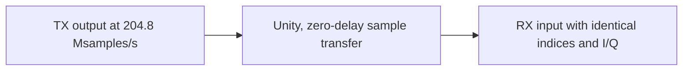

# Channel: noiseless reference connection

This model transfers TX complex-envelope sample blocks to the RX input plane
with unity complex gain and zero delay. It adds no noise, filtering, phase/frequency
offset or resampling. Absolute sample ticks and block values are preserved.

It owns no hidden history. Dividing the same stream into different bounded blocks
does not change the transfer. The matched RX independently holds its explicit
known unity response; it does not query TX state. This reference establishes the
baseline for later channel models, not a measured cable plant or multipath
simulation. Channel input/output [test points](observations.md) label both planes.
