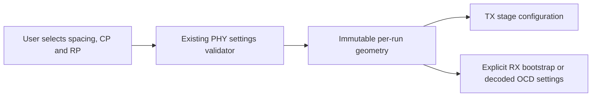

# Per-run waveform geometry

Geometry owns an immutable copy of validated transmission settings. TX and RX
construct their own stages from those values; editing the caller's settings later
does not alter active prefix length, roll-off or symbol cadence.

At $F_s=204800000$ samples/s, spacing selects $N=8192$ or $4096$. Prefix $C$
and roll-off $R$ give stride $L=N+C$ and extended window length $L+R$.
Configuration requires $R<C$ and the existing permitted sample counts.
A different prefix/roll-off starts a new configured session, rather than changing
state in the middle of an overlap or partial received symbol. Geometry does not
own carrier assignments, payload state or sample buffers.
