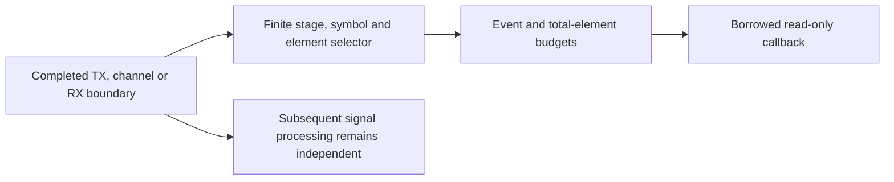

# Waveform test points

Waveform observations reuse the common bounded, opt-in test-point dispatcher.
Producers operate on completed outputs; callbacks never receive mutable TX/RX
state and cannot change overlap, framing, samples or decoder decisions.

| Direction | IDs | Domain |
| --- | --- | --- |
| TX | `tx.ifft.samples`, `tx.cp.samples`, `tx.window.samples`, `tx.overlap_add.samples` | Time samples |
| TX output / RX input | `channel.input`, `channel.output` | Time samples, preserved absolute ticks |
| RX | `rx.framed.samples`, `rx.cp.samples` | Received period / useful time samples |
| RX | `rx.fft.bins`, `rx.equalized.iq` | Increasing physical frequency bins |
| RX | `rx.plc.iq` | Ascending local PLC cells |
| RX | `rx.pilots.iq` | Sparse records retaining physical bin and pilot role |
| RX | `rx.reduced.iq` | Reduced carrier rank with scattered placeholders |

Metadata retains spacing, prefix, roll-off, 204.8MHz sample clock, physical origin,
channel symbol/PLC phase and full source-array length. Time events identify the
first sample of the full boundary; `element_start` adds the selected offset.
Useful time samples start CP ticks after the period/window start. Frequencies
remain identified by physical origin and spacing, not by selected array length.
The reference amplitude describes the digital source convention, not RF power.

Existing maximum budgets apply: 32 selected stages, 100,000 events, 65,536 elements
per event and 1,048,576 total elements. Disabled probes make no callbacks;
exhausted budgets skip events without altering science. Failed callbacks consume
budget and return an error while the caller retains completed stage results.
Tests compare complete experiments with observation disabled/enabled/exhausted,
and verify subsequent overlap state after a deliberate callback failure.
