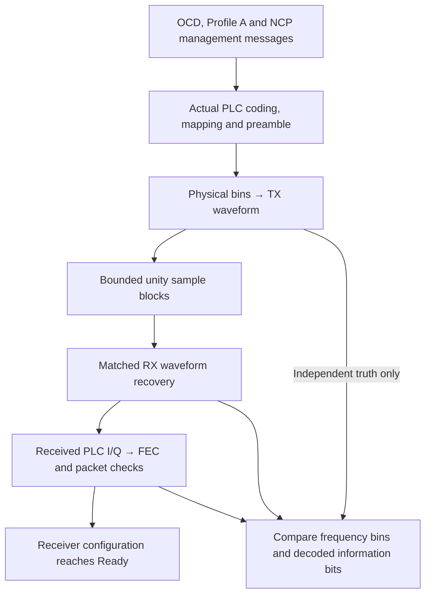

# Noiseless waveform reference experiment

Run the bounded shared Rust experiment:

```bash
./scripts/cargo-local.sh run -p docsis-ofdm-fec --example waveform_channel --locked
```

It streams two complete PLC frames at each spacing. Each physical symbol contains
actual PLC FEC/QAM or preamble cells, actual continuous/scattered pilots, explicit
exclusions and deterministic 256-QAM reference data cells. TX performs IFFT,
prefix, suffix/window and overlap-add. A unity sample channel feeds the independent
known-reference RX in 137-sample chunks, splitting prefix/useful boundaries.



The compact JSON reports symbols/bins/pilots actually compared, maximum complex
bin error, compared PLC information bits, bit errors, actual LDPC iterations,
preamble checks, configuration readiness and final drain/remainder counts.
The soft demapper uses a positive reference variance to produce finite LLRs;
this does not inject noise into the sample channel.
A successful noiseless run has zero compared information-bit errors. Floating
FFT roundoff is reported numerically rather than called bit-perfect I/Q.

Configuration permits one or two frames, bounded chunk sizes and explicit sample
origin/reference RMS. It retains only a symbol's stage buffers, a PLC frame and
bounded receive/overlap state; it does not retain an entire second of samples.
No random draw, host time, RF device, filesystem capture or Python sidecar enters
the scientific runner. Callback failures stop this short synchronous experiment;
this is not the cancellable production runner with partial-job result accounting.

The example uses a 24MHz synthetic active envelope. Transform/window unit tests
cover both complete FFT grids and every permitted CP/RP combination. Additional
pilot positions are explicitly supplied as in earlier fixtures. External modem
interoperability, encoded payload/NCP waveform delivery, a full 192MHz payload
run, blind acquisition, impairments and one-second lifecycle remain separate
checklist work; successful PLC recovery does not establish those behaviors.

The separate [actual payload experiment](../payload-transport/reference-experiment.md)
now adds encoded data/NCP transport through the same waveform stages. The
original waveform-only example above deliberately retains its reference-data scope.
