# WAVE-RX: receiver acquisition

The receiver can now choose between supplied **25 kHz and 50 kHz bootstrap
hypotheses**, find symbol timing, correct fractional and whole-subcarrier carrier
frequency offset (CFO), and recover the scattered-pilot phase. It estimates the
channel from received pilots before correcting and extracting the data.

A hypothesis is a possible receiver configuration: spacing, cyclic prefix,
roll-off and carrier/pilot map. The receiver chooses using the samples, not a
transmitter object. CP/RP and maps must be supplied as possibilities; the operation
does not discover an arbitrary RF channel or decode its configuration by itself.
The sample rate remains 204.8 Msamples/s. Equal hypotheses are rejected; configurations
that produce indistinguishable samples also reject rather than silently choosing.

```mermaid
flowchart LR
    S[Received samples] --> CP[CP timing and fractional CFO per hypothesis]
    CONFIG[Bootstrap possibilities] --> CP
    CP --> FFT[Fractional derotation and two symbol FFTs]
    FFT --> INTEGER[Search integer carrier shifts]
    INTEGER --> FIT[Fit channel using continuous pilots]
    FIT --> PHASE[Score held-out scattered pilots over two symbols]
    PHASE --> SELECT[Select unique supported hypothesis]
    SELECT --> RX[Continuous total CFO correction]
    RX --> EQ[Pilot CH-EST-RX and equalization]
    EQ --> OUT[Recovered I/Q and separate data/control paths]
```

## Timing and fractional offset

For FFT length $N$, use the untapered prefix samples $r[n]$ and their repeated
counterparts $r[n+N]$:

$$
C(d)=\sum_n r[d+n]^*r[d+n+N],\qquad
\rho(d)=\frac{|C(d)|^2}{\sum_n|r[d+n]|^2\sum_n|r[d+n+N]|^2},
$$

$$
\widehat{\Delta f}_{frac}=\frac{F_s}{2\pi N}\arg C(\hat d),\qquad F_s=204.8\text{ MHz}.
$$

This offset is aliased modulo subcarrier spacing. A whole-subcarrier offset is
therefore invisible to the CP frequency estimate alone. CP timing may move within
an ISI-free part of the prefix; pilot estimation removes the associated phase slope.

## Integer offset and phase

For each integer carrier shift $m$, align the received FFT bins using
$Z[k]=Y[(k+m)\bmod N]$. Fit $\hat H[k]=Z[k]/P[k]$ at continuous pilots and
interpolate to predict scattered-pilot observations. The scattered pilots are
held out of the channel fit. For candidate initial phase $s$, score **two**
consecutive symbols, using the corresponding pilot phase $s+t$:

$$
E_s=\frac{\sum_{t=0}^{1}\sum_{k\in\mathcal P_{s+t}}
 |Z_t[k]-\hat H_t[k]P[k]|^2}
{\sum_{t=0}^{1}\sum_{k\in\mathcal P_{s+t}}|\hat H_t[k]P[k]|^2}.
$$

Two symbols provide enough pilot observations for narrow 24 MHz/50 kHz
configurations where one symbol can have too few. At least two observations per
candidate phase are required across the combined window. Pilot phase must win
with error no greater than 0.2 and runner-up gap at least 0.1. Different accepted
numerology/integer hypotheses need an error gap of at least 0.05. These are
engineering admission policies, not CableLabs receiver thresholds.

Combine the offsets and correct samples continuously:

$$
\widehat{\Delta f}=\widehat{\Delta f}_{frac}+mF_s/N,\qquad
r_c[n]=r[n]e^{-j2\pi\widehat{\Delta f}(n-n_0)/F_s}.
$$

The same origin $n_0$ applies to all later input blocks, avoiding phase jumps when
samples are split. The live receiver consumes the acquisition window once and
continues with raw contiguous sample blocks.

## Limits and test points

Search accepts at most eight hypotheses, a timing search of at most 1,024 samples
and a selected integer radius from 0 through 16 carriers. The input must cover
**two periods plus the timing search** for every candidate, even a candidate that
will lose. This prevents silently preferring a shorter FFT because it fits the
available window. Invalid maps/policies, insufficient samples, silence, weak
pilots, ambiguous candidates and unsupported offsets reject explicitly.

Results expose selected hypothesis index, integer/fractional/total CFO, timing,
pilot phase and prediction error. Normal receiver outputs retain corrected period,
useful samples, raw FFT bins, pilot estimates, equalized bins and extracted
signals. Original uncorrected samples stay caller-owned. Phase 0–127 is not an
absolute PLC frame epoch and does not replace PLC preamble/message decoding.
The channel CLI keeps its explicit synchronized reference mode; search is an
opt-in Rust receiver operation.

## Verified model

Tests cover both spacings at 24, 90 and 192 MHz, signed integer offsets, fractional
CFO, unknown timing/phase, complex gain, seeded additive sample perturbations and
actual time-domain reflected paths at 4 and 12 samples. Reflected gains are 0.15
and -0.07 of the direct signal and lie within the selected 512-sample prefix.
Tests compare received/equalized QAM symbols, verify split-block invariance and
recover a known BCH/LDPC-coded block with zero post-FEC errors in all six
width/spacing combinations. The isolated coded-block check does not claim live
NCP/PLC acquisition; those stages have separate integration tests.

Deep fades, excessive delay beyond the prefix, arbitrary RF acquisition, sample-rate
error and externally generated full-channel interoperability are not established
by these synthetic checks. External interoperability is outside the minimum
closed-loop QA-05 scope. Existing single-symbol,
known-numerology fractional-only operations remain available; narrow channels
should use the two-symbol search path.

Design: [WAVE-RX-05](../../development/features/receiver-acquisition/design.md).
