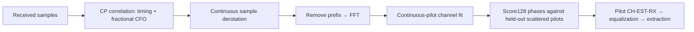

# WAVE-RX: bounded nonideal acquisition

This receiver starts with known FFT size, cyclic prefix, roll-off and carrier
layout. It derives a sample boundary, fractional carrier-frequency offset (CFO)
and the scattered-pilot phase from received samples. It then estimates channel
response from received pilots and applies correction before extraction.

For FFT length $N$, use the untapered prefix samples $r[n]$ and their repeated
counterparts $r[n+N]$. The timing score and fractional CFO are

$$
C(d)=\sum_n r[d+n]^*r[d+n+N],\qquad
\rho(d)=\frac{|C(d)|^2}{\sum_n|r[d+n]|^2\sum_n|r[d+n+N]|^2},
$$

$$
\widehat{\Delta f}=\frac{F_s}{2\pi N}\arg C(\hat d),\qquad
r_c[n]=r[n]e^{-j2\pi\widehat{\Delta f}(n-n_0)/F_s},\quad F_s=204.8\text{ MHz}.
$$

CFO is aliased modulo subcarrier spacing. Restrict this experiment to offsets
strictly within half a subcarrier; integer-CFO and unknown-numerology acquisition
are not implemented. Absolute sample ticks keep correction phase continuous when
blocks split. CP timing can shift slightly within its safe region under noise.

Continuous pilots provide $\hat H[k]=Y[k]/P[k]$. Interpolation produces a prediction
for each candidate scattered-pilot phase. Those scattered pilots were **not** used
in that fit. Score each phase using

$$
E_s=\frac{\sum_{k\in\mathcal P_s}|Y[k]-\hat H[k]P[k]|^2}
{\sum_{k\in\mathcal P_s}|\hat H[k]P[k]|^2}.
$$

Require at least two scattered pilots per candidate, a winning score no greater
than0.2 and a runner-up gap of at least0.1. These are engineering admission limits,
not CableLabs receiver thresholds. Reject silence, weak correlation and ambiguous
phase. The interpolation assumes a sufficiently smooth channel between continuous
pilots; arbitrary deep fades/delay spread are not certified by this acquisition.

The result exposes measured timing/CFO/phase/error and the normal raw/equalized
receiver test points. The framed period/FFT bins are after CFO correction and
before channel equalization; the caller retains the original raw input. Its symbol ID starts at the recovered phase0..127; this does
not identify an absolute PLC frame epoch or replace PLC preamble/message decoding.
The standard channel CLI retains its explicitly synchronized reference mode.

Tests cover both spacings, unknown timing/phase, a smooth complex gain,1800Hz CFO
and seeded additive sample perturbations. Correction is exactly chunk-independent;
no transmitted H, timing or phase is supplied to the acquisition function. External
full-channel validation remains QA-05.
