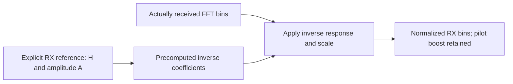

# RX: supplied reference equalization

The initial equalizer uses caller-supplied finite nonzero per-bin complex channel
gains $H[k]$ and a positive amplitude reference $A$. It reconstructs normalized
cells from received FFT bins:

$$
Q[k]=\frac{\widehat X[k]}{A H[k]}.
$$

The inverse uses scaled complex arithmetic to avoid squaring an enormous gain.
Zero gains, nonfinite values, unrepresentable inverses and nonfinite products
are rejected. The reference experiment supplies unity $H$; the standalone stage
also has an independently calculated complex-gain test. No propagation response
is estimated here. Channel estimation and blind equalization are later work.
Pilots retain their twofold amplitude boost, allowing extraction and comparison
without silently normalizing them to data amplitude.
