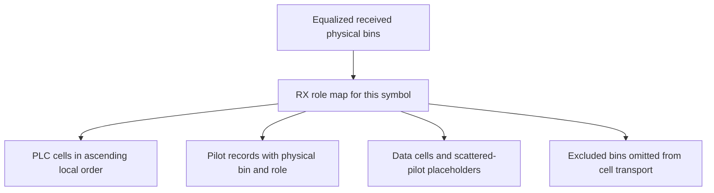

# RX: pilot, PLC and reduced-cell extraction

Extraction uses the receiver's physical carrier map and received channel-symbol
phase. It walks normalized bins in increasing frequency order, retaining their
physical associations rather than packing all active bins into payload.

Continuous/scattered pilot records preserve bin, role and received I/Q. PLC cells
feed the existing independent soft decoder. The reduced domain preserves a
`None` placeholder for each scattered pilot; those placeholders describe protected
roles, not unavailable received samples. Other data locations hold received
cells and may later carry NCP. Extraction does not infer NCP assignment or decode
payload. Wrong grid length or nonfinite I/Q fails before producing a result.
