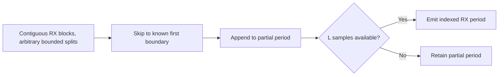

# RX: known-reference symbol framing

The framer accepts contiguous received sample blocks, an explicitly known first
symbol boundary and a starting PLC-aligned symbol index. It can skip leading
samples before that boundary and then collects complete $L=N+C$ periods.

Pending storage stays shorter than one period. Each output carries its original
sample tick and symbol index, including across input splits within the prefix or
useful region. Gaps, repeats and index overflow are rejected atomically.
Partial input is never zero-filled or counted as a recovered symbol.

At stream end, the final TX roll-off tail can remain pending. It is reported
explicitly; a truncated final period is likewise visible through the remainder
count. Starting a new framer discards old timing/history. This is known-reference
framing, not a blind synchronization algorithm; nonideal acquisition is still
WAVE-RX-05.
