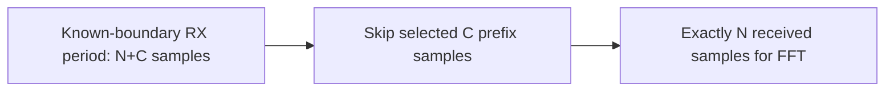

# RX: cyclic-prefix removal

RX removal takes a correctly framed period of $N+C$ received samples and selects
$N$ useful samples starting at offset $C$. It borrows this slice without altering
the period. It neither regenerates the prefix nor uses transmitter useful data.

The TX taper affects only the first $R$ prefix samples and the appended suffix.
Since $R<C$, the default useful RX window lies in the flat part. Adjacent overlap
affects prefix samples, not this useful window in the noiseless reference case.
Wrong-sized or nonfinite periods are rejected; incomplete input waits in the
[framer](rx-framing.md). Removing a prefix does not prove timing acquisition or
multipath tolerance; nonideal receiver work remains separate.
