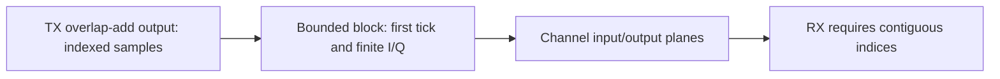

# Sample blocks and reference planes

A sample block owns at most 65,536 finite complex pairs and its absolute first
sample tick. All blocks use the fixed 204.8 Msamples/s clock. An index is simulated
time identity, not wall time. Complex amplitudes have the documented digital
reference scale; they are not dBmV or measured RF power.

The exclusive end is checked for overflow during construction. Channel transfer
preserves indices and values. RX rejects gaps or repeats instead of filling
samples; partial periods stay in its bounded framer. Empty terminal blocks are
permitted and consume no ticks. Large streams must use repeated blocks, not an
allocation containing one second of samples.
