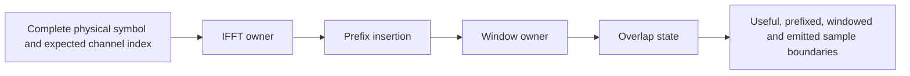

# TX subsystem composition

The waveform transmitter owns separate immutable geometry, IFFT plan, window
and overlap-add state. Its only simulation input per call is one complete assembled
physical symbol. It does not decide carrier allocation or implement FEC.

Spacing, FFT size and sequential symbol identity are checked. Missing-history
cells are rejected rather than silently changed to zero. The caller must supply
an explicit valid startup/filler plane before asking for a waveform. Simulation
stage buffers are returned for direct inspection; the state retains plans and
the overlap tail, not the full stream. Rejection before overlap commit leaves
TX sequence/history intact. Finishing drains the tail and closes the session;
construct a new transmitter for different settings.
