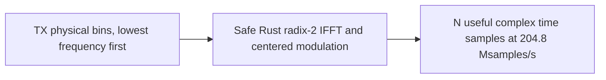

# TX: centered unitary IFFT

The TX transform synthesizes a useful time symbol from all $N$ physical bins,
with bin zero the lowest frequency and bin $N-1$ the highest. This is the PHY
ordering, rather than an FFT library's DC-first ordering.

The local PHY I20 §7.5.7.1/PDF133 defines

$$
x[n]=\frac{1}{\sqrt N}\sum_{k=0}^{N-1}X[k]
 e^{j2\pi n(k-N/2)/N}.
$$

A reusable immutable plan precomputes roots and bit reversal. One internal
butterfly implementation serves both directions; the TX wrapper applies the
centered sign and unitary normalization. Discrete energy is preserved:
$\sum_n|x[n]|^2=\sum_k|X[k]|^2$. No additional RMS normalization or RF frequency
translation is performed. Wrong sizes, nonfinite inputs and nonfinite output
are rejected. Independent DC, quarter-tone, lowest-bin and direct-sum vectors
verify ordering and amplitude, alongside the matched [RX FFT](rx-fft.md).
