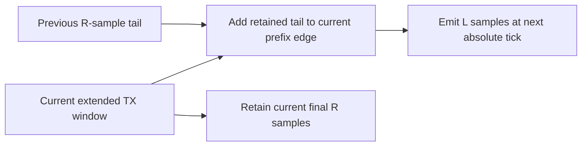

# TX: overlap-add stream state

The overlap owner retains only the final $R$ samples of the preceding window.
Each new window emits $L=N+C$ samples, adding the previous tail to its first
$R$ values. The current tail is saved for the next call.

For neighboring windows, the overlap is $z_{m-1}[L+i]+z_m[i]$ for $0\le i<R$.
Roll-off adds no symbol cadence: starts remain $L$ samples apart. Startup has
no fabricated preceding tail. Finishing emits the final $R$ samples once,
then closes the stream; repeated finish calls produce no further samples.
Reset explicitly discards history and selects a new stream start.

Shape/numeric/index failures leave existing history unchanged. Output is checked
for finite sums before state commits. Tests compare a complete stream against an
independent shifted-window sum, including startup, tail, zero roll-off,
rejected-call invariance and checked sample-clock overflow.
