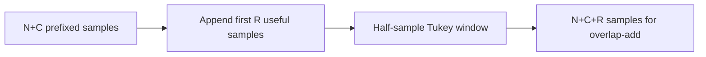

# TX: cyclic suffix and windowing

Windowing owns a frozen coefficient vector. It appends the first $R$ useful
samples as a cyclic suffix to the $L=N+C$ prefixed samples, then applies the
symmetric PHY taper. The result has $L+R$ samples.

The rising edge is the following equivalent form of the local PDF69 equation:

$$
a[i]=\tfrac12\left(1-\cos\frac{\pi(i+1/2)}R\right),\quad 0\le i<R.
$$

Thus $w[i]=a[i]$, $w[L+i]=1-a[i]$, and $w[i]=1$ for $R\le i<L$.
The half-sample offset matters: endpoints are not simply zero and one.
For zero roll-off the window is rectangular and no division by zero occurs.
Adjacent complementary coefficients sum to one, but consecutive symbols can
carry different samples; [overlap-add](tx-overlap.md) sums their contributions.
Tests verify symmetry, complementarity, suffix values and the independent window
energy identity $\sum_i w[i]^2=L-R/4$ for every permitted pair at both spacings.
