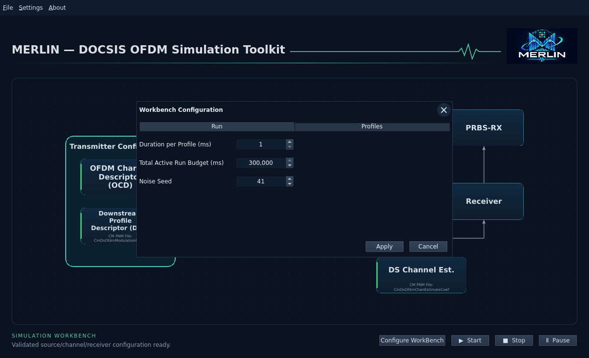
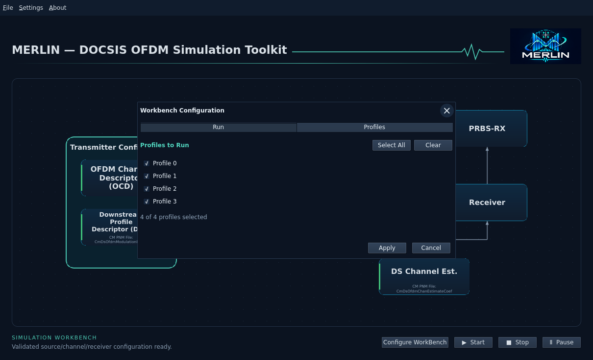

# Workbench configuration

Choose **File → New** to create a blank workbench, or **File → Open…** to load
one. **Configure WorkBench** sits immediately before Start at the lower right. It is
disabled before creating/opening a WB and during a simulation. A successful
first Save also creates and activates a WB. A canceled or failed Open
preserves the current WB. New asks before clearing an active WB; save first to
keep your edits.

## Run

Set observation **Duration per Profile**, **Total Active Run Budget** and
**Noise Seed**. The budget covers the entire selection, excluding paused time.
Each profile starts an independent simulation with the same accepted channel,
source and seeds. Profile capacity can change the number of processed codewords.

## Profiles

Check the imported captured profile IDs you want to run. **Select All** checks
them all; **Clear** unchecks them all. New WBs initially use only the applied DPD
profile. Imported legacy WBs retain their saved all/applied behavior. Changing
run selections does not change the DPD applied profile or capture bytes.

An empty selection can be saved, but Start stays disabled. Import DPD to populate
the choices. If a different DPD removes a selected ID, choose a valid selection
before starting. Compatible selected profiles run in captured-ID order; failures
are reported rather than silently substituting another profile.

Apply accepts this dialog's draft; Cancel/X discards it. Configuration is available
while input blocks are yellow so you can complete setup in any order. Start
requires accepted input compatibility, receiver options, independent comparison,
a selected profile, all-green blocks and an idle worker.

**Receiver → Configure Receiver…** retains only receiver correction mode and
LDPC iteration limit. They remain part of the same accepted WB configuration;
editing either dialog preserves the other settings.

Save and Save As write schema-2 self-contained WB JSON, including selected IDs
and original inputs. Open accepts schema1 with its original all/applied semantics;
unsupported versions and invalid/duplicate/missing profile IDs are rejected
before changing the current WB. Update recovery uses the same saved settings.
Run results and unapplied editor drafts are not configuration.

See [run/save](closed-loop-workbench.md) and
[receiver profile performance](receiver-profile-performance.md).

All configuration editors use **Apply** then **Cancel** in one row at the lower
right. Apply accepts the changes; Cancel or the title X discards the draft.
Secondary actions such as Reset defaults stay to the left.
