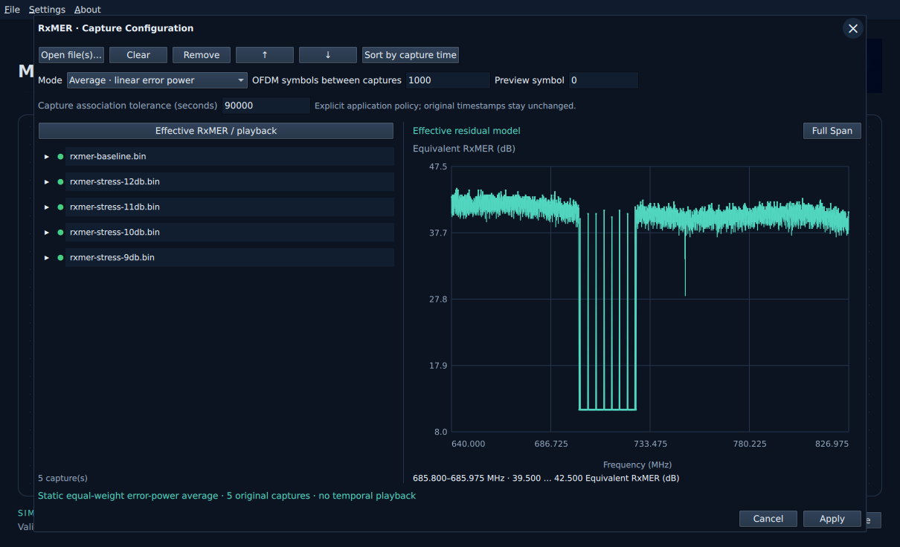
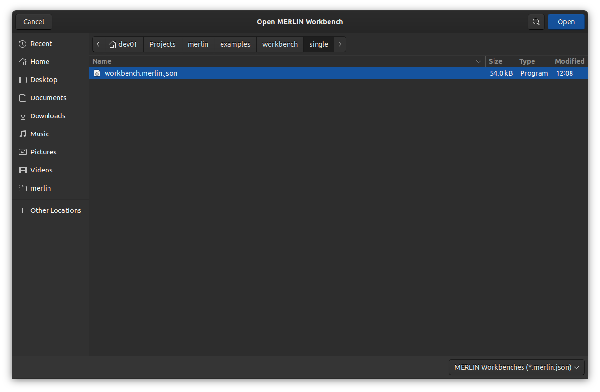

# Open a workbench example

Native **File → Open** and individual input-file pickers start in the curated
examples folder. Open a scenario directory and choose `workbench.merlin.json`.
The main **File → Open** filter is **MERLIN Workbenches (*.merlin.json)**.
It hides binary captures and metadata JSON while preserving folder navigation.
The input-block file pickers remain separate.
You can also select that directory's original PNM files in the owning blocks.
Save/Save As keep the operating system's normal destination selection.

| Scenario | Files beside the WB | Default behavior |
| --- | --- | --- |
| `single` | One modulation profile, one RxMER, one DS channel estimate | Single RxMER input |
| `multi-rxmer` | One modulation profile, five RxMER files, one DS channel estimate | Average linear residual power |
| `multi-rxmer-2` | One modulation profile and 132 channel 193 RxMER files; no DS channel estimate | Average residual power; flat/unity channel response |
| `multi-rxmer-dschan` | Reserved documentation only | Varying channel-estimate playback is deferred |

The runnable WBs use Profile A/ID 0, a PRBS15 source, independent comparison and
a 1 ms pilot-estimated receiver. Example validation uses the same Rust import and
full request preparation as the UI. This does not promise zero errors: the stress
RxMER inputs deliberately increase residual error power. No simulation starts
automatically when a WB is opened.

The `single` and `multi-rxmer` captures share modem `00:ca:00:00:00:01`, channel 34, zero frequency
631.100 MHz, first index 356 and 25 kHz spacing. The 7,480 measurement positions
span 640.000–826.975 MHz and match the selected DPD. Capture epochs differ; the
90,000-second association tolerance is explicit. Synthetic RxMER alternatives
retain the baseline epoch and are not successive measured events. Do not infer
measured time evolution from their filenames or reorder them as capture history.

`multi-rxmer-2` contains the pre-collected channel 193 RxMER series and its
companion modulation profile from PyPNM. The source filename timestamps span
about 61 minutes, including a roughly 46-minute gap. No companion channel
estimate was found: the WB uses a flat/unity supplied response and pilot-estimated
receiver correction. Average mode combines linear residual power across all
132 captures. Hold/interpolate modes use the configured OFDM-symbol interval;
they do not reproduce the irregular acquisition cadence. Original header capture
times remain unchanged. See the [bundle notes](../../examples/workbench/multi-rxmer-2/README.md).

The WBs embed exact input bytes with hashes, so copying a WB alone preserves
its configuration. Each bundle also carries original files, provenance and
upstream LICENSE/NOTICE. See the [source inventory](../../examples/workbench/README.md).

## Development and installed paths

Development builds find `examples/workbench/` relative to the executable's
marked source checkout, independently of the shell's working directory.
The former top-level `examples/workbench.merlin.json` moved into `single/`.

Future desktop installers must include these same curated bundles. The native
Open resolver already recognizes these layouts:

| Application layout | Examples root |
| --- | --- |
| Linux shared resources | `../share/merlin/examples/workbench` relative to the executable directory |
| Portable Windows/Linux | `files/examples/workbench` beside the executable |
| macOS bundle | `Contents/Resources/examples/workbench` |

These are packaging contracts and tested path layouts, not a claim that desktop
installers or non-Ubuntu native pickers have shipped. Installed-OS acceptance
must verify file hashes, offline restore and default Open location after moving
the application and launching it from an unrelated directory. When example
resources are absent, native Open remains usable with the OS default location.

