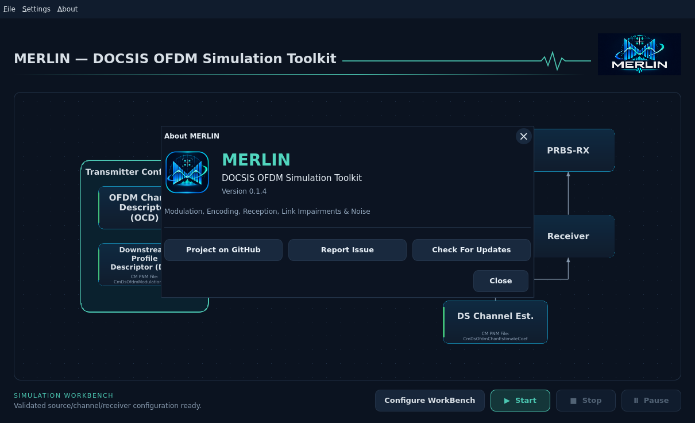
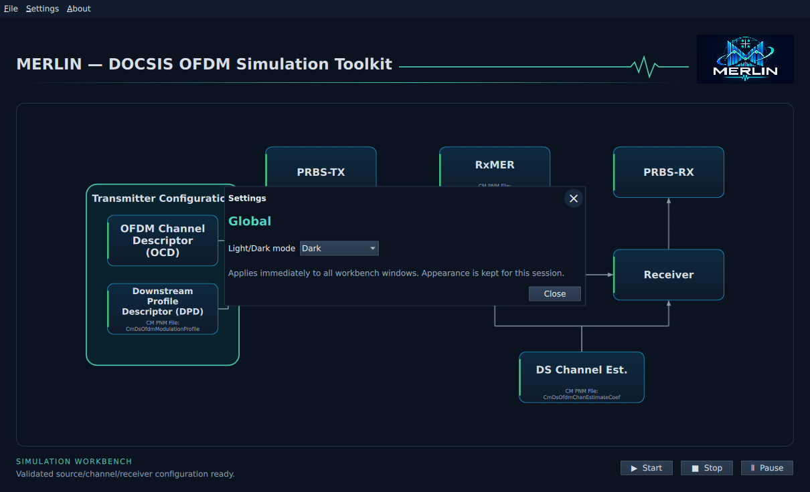
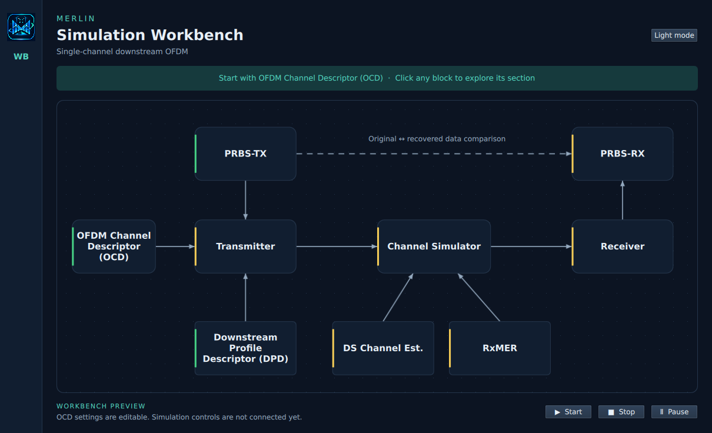
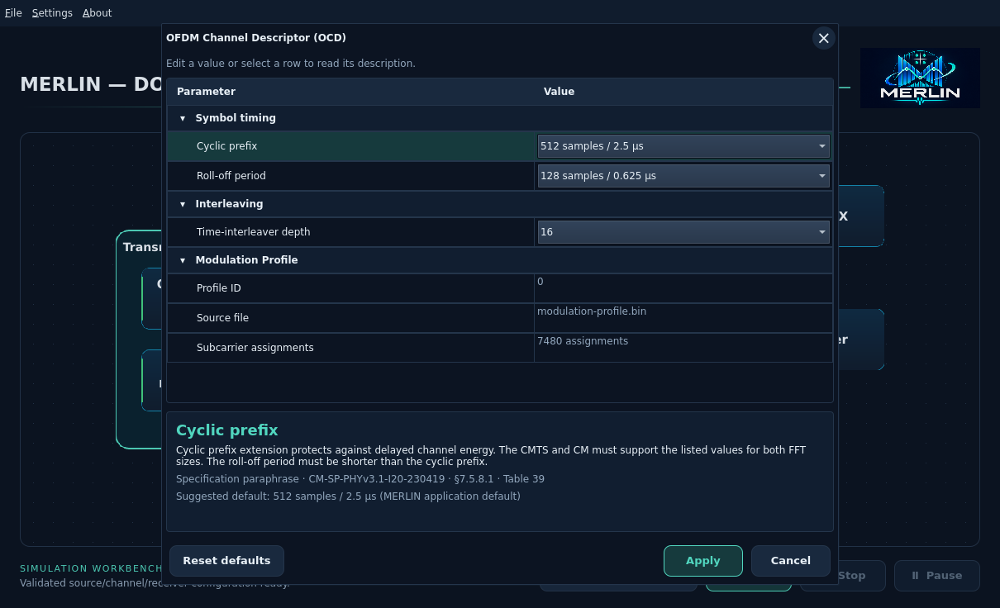
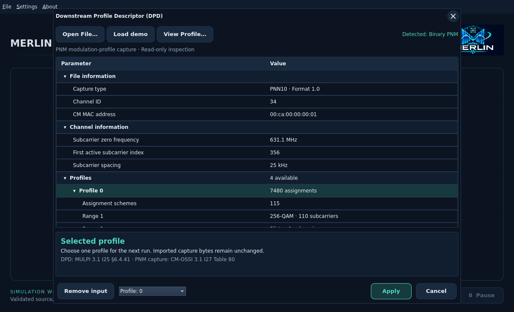

# MERLIN Simulation Workbench

The native Qt workbench starts with the single-channel system diagram. Click
OFDM Channel Descriptor (OCD), PRBS-TX, Transmitter, Channel Simulator, Receiver, PRBS-RX or one
of the measurement-input blocks to open its section dialog. Close the dialog
or press Escape to return. Use **Settings → Global → Light/Dark mode** to change the palette and icon
across all windows. The change applies immediately and lasts for this session.

The standard menu bar at the top is **File | Settings | About**. File contains
**Open…**, **Save** and **Save As…** for self-contained `*.merlin.json` workbenches.
Original PNM/payload bytes and accepted block settings are embedded; see the
[run/save guide](closed-loop-workbench.md). Load individual captures in their dialogs.
About shows the active icon, compiled version, MERLIN's expanded name and project
link. License/NOTICE links open bundled text offline. Title bars use consistent
initial capitals and the light/dark icons share transparent rounded corners.

The instruction banner and standalone theme button have been removed.

The workbench includes an editable **OFDM Channel Descriptor (OCD)** dialog. PRBS-TX supports source configuration. Channel Estimate and RxMER use the shared
[measurement viewer](channel-measurements.md); Transmitter opens the shared [Spectrum Analyzer](spectrum-analyzer.md).
The [Receiver Workbench](receiver-workbench.md) adds NCP/PLC/data-profile
QAM selection and an independent SA test-point selector.
DPD and measurement blocks support capture input. Configure Receiver and enable
PRBS-RX independent comparison to complete next-run readiness. The lower-right
Start, Stop and Pause/Resume controls now drive a bounded Rust closed-loop worker.
Receiver instruments read real retained observations; NCP scatter collection is
still pending.

Development proceeds left to right from OFDM Channel Descriptor (OCD). The PRBS-TX/PRBS-RX
connection means original/recovered data comparison, not receiver feedback.
Measurement input blocks will use supported decoded PNM JSON. The existing
[channel CLI](channel-runner/cli.md) remains available for actual simulations.

See [Qt setup and VM launch](../development/qt.md) and the
[UI checklist](../development/ui-checklist.md). The interface remains in the dev
phase; initial Ubuntu targets require separate native validation.

## PRBS-TX options

Click PRBS-TX to open **Transmit source (PRBS-TX)**.
Choose continuous PRBS15 or a text/binary file in a tree like the OCD editor.
The [dark interactive design preview](../images/workbench/prbs-tx-design.html)
shows the proposed tree, conditional File/fill controls and Apply/Cancel. It is
a mockup, not runtime evidence; its Open action does not access files.

- **PRBS15:** set a nonzero seed from 1 to 32767; the initial draft uses 32767.
- **File:** select a file through the OS picker. Rust preserves its exact bytes
  and reports filename, size and SHA-256. Text is not re-encoded. Maximum: 16 MiB.
- **Append PRBS15:** optional and initially off. Set a total meaningful-bit target
  including the file, plus a separate seed. The target must be at least the file's
  bit count and at most 134217728 bits. A summary shows how many bits are appended.

Without append, a file is sent once and followed by idle/filler. Empty files are
allowed; positive fill can supply finite traffic. The total need not be byte-aligned.
Run duration is configured separately and does not guarantee complete file recovery.
See the [source editor guide](source-input.md) for actual dark VM screenshots.
Apply accepts a validated source for the next run; Cancel preserves the previous
selection. Only explicit acceptance makes PRBS-TX green. Other blocks and run
integration must also be ready before Start is available.

See [PRBS15 behavior](simulation/prbs.md) and
[file and fill behavior](simulation/file-source/README.md) for existing Rust support.

## Block status

Blocks show their name only. Their left stripe indicates status:

| Color | Meaning |
| --- | --- |
| Green | Complete: the block's requirements are satisfied. |
| Yellow | Needs attention: input, configuration or results are missing/pending. |
| Red | Error: an input, configuration or processing failure has a diagnostic. |

Hover over a block, or focus it with the keyboard, to see its status and reason.
Screen readers receive the same explanation. Click the block for its dialog.

**OCD stays yellow until a compatible modulation-profile input is accepted and
its settings are valid.** Applying a compatible profile through DPD turns both
blocks green. Missing input is yellow; an accepted input that becomes incompatible
is red. A rejected draft remains in its editor with a diagnostic and preserves
the accepted selection. Applying timing settings alone does not satisfy the input
requirement.

**Start requires every block to be green.** A yellow or red block disables it.
Green before a run means configured and ready; comparison results are not needed
to start the run. Start is enabled only for an idle worker and a fully validated
frozen request. Optional inputs may satisfy readiness through an explicit valid
bypass/default mode when those controls are implemented.

Receiver remains yellow until its full-request configuration is applied; PRBS-RX
requires independent comparison acceptance. Visiting analyzer tabs has no effect.
Optional measurement inputs will not be required for every future run.

## Edit OFDM transmission settings

Click **OFDM Channel Descriptor (OCD)** in the diagram to open its Parameter/Value tree. Expand
or collapse **Symbol timing**, **Interleaving** and **Modulation Profile**. Edit
cyclic prefix, roll-off period and time-interleaver depth in the Value column.
Select a row or focus its dropdown to read its description and specification
reference below the tree.

The **Modulation Profile** branch shows Profile ID, Source file and Subcarrier
assignments. Values start blank; applying a profile in DPD fills them. Removing
the accepted input clears them again. Application defaults do not imply that a
profile has been selected.

DOCSIS uses **OFDM Channel Descriptor (OCD)** for common channel parameters and
**Downstream Profile Descriptor (DPD)** for profile parameters, including modulation
assignments. They are separate concepts (MULPI 3.1 I25 §§6.4.40–6.4.41; PHY 3.1
I20 §7.5.13.4). The previous Channel context label has been removed. Bandwidth and
spacing remain in the core configuration but are not editable in this dialog;
channel/profile import integration remains pending. This dialog alone does not
configure a complete transmission or import/export a complete OCD message.

**Apply** validates the draft in Rust and retains it in this application session.
Invalid combinations remain open with an error and do not replace the last
accepted configuration. Roll-off must be shorter than the prefix. Interleaver
depth must be at most 16 for 25 kHz spacing or 32 for 50 kHz spacing. Zero roll-off
is evaluation-only. The interleaver-depth limit uses the channel spacing held by
Rust. Channel settings will need to be reconciled when profile input is connected.

**Cancel** or **Escape** discards edits. Reopening restores the last applied
values. **Reset defaults** changes the draft to MERLIN's application defaults;
press Apply to accept them. These defaults are not mandated by the specification.
See [transmission settings](transmission.md) for the supported values and units.

Settings are held in memory only and reset when the application closes. Run
integration and workbench-file saving remain pending. The bundled
`resources/registry/ofdm-settings.json` describes the fields; the proposed
`*.merlin.json` workbench format will separately store values and input references.

## Planned application navigation

- **Open:** restore a saved workbench configuration without starting a run.
- **Settings:** change application preferences such as theme.
- **About:** view MERLIN's expanded name, version, licenses and acknowledgements.

These actions are planned. Measurement-file selection will remain in its owning
workbench block. User-guide screenshots and graphics use the dark theme;
light-theme support remains available in the application.

## Downstream Profile Descriptor (DPD)

Click the **Downstream Profile Descriptor (DPD)** block. **Open File** accepts a
binary modulation-profile PNM capture (including `.bin`/`.pnm`) or supported
decoded JSON. **Load demo** stages the sanitized embedded binary without searching
for a source-checkout path. Detection uses file contents, not the extension.

Expand File information, Channel information and Profiles. Choose a profile from
the dropdown or its tree row; inspect numbered **Range** entries and select rows
for details. Input provenance is separately expandable. Values are read-only.

**Apply** validates compatibility with accepted OCD settings and accepts the
selection for this session. **Cancel/Escape** discards staged changes. **Remove
input** stages removal; Apply commits it and returns OCD/DPD to yellow. Rejected
files preserve the previous draft and accepted selection. Nothing overwrites the
original file. This does not start a simulation or save a workbench.

See [supported profile files and limits](measurement-inputs/modulation-profile.md).
The [original dark mockup](../images/workbench/dpd-design-dark.png) is a design
reference; the screenshot above is the actual native application.

## Workbench configuration files (planned)

A WB configuration will be a versioned **JSON** document containing all PNM
inputs and each block's accepted settings. Opening it will restore the configured
workbench without starting a simulation. Saving it will preserve the current
configuration, including PNM/profile associations; it will not modify the source
PNM files. Exact storage encoding and size limits are still being designed.
The File menu is present, but Open/Save are not yet implemented.
