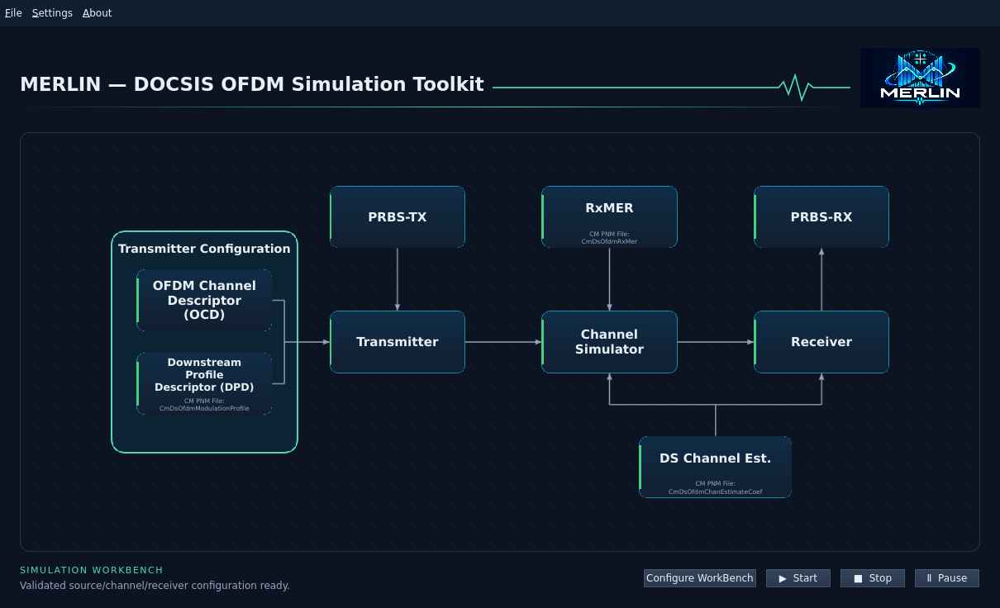
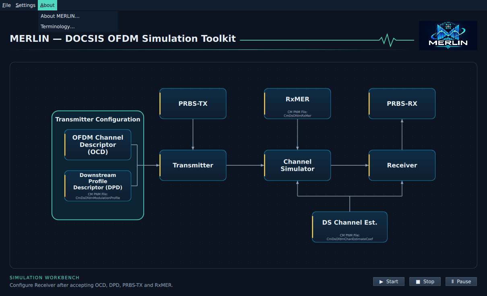
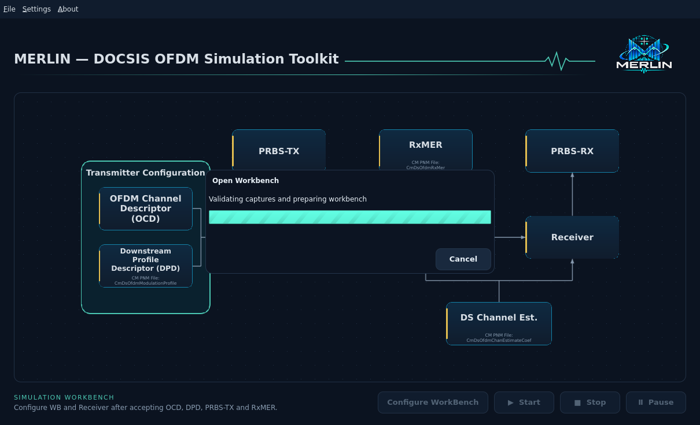
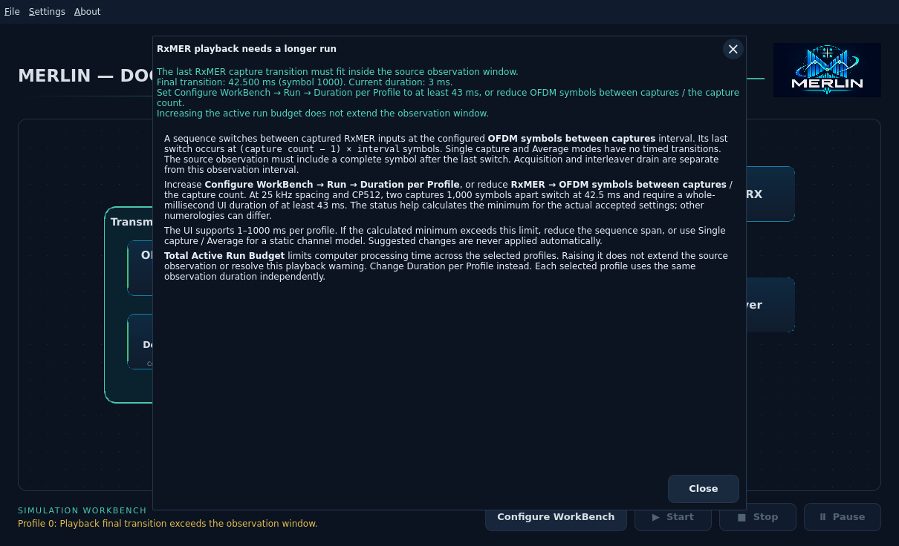

# MERLIN Simulation Workbench

The [README overview](../../README.md#workbench-overview) uses matching dark/light
system illustrations. They show the signal connections; the images below show
the actual native interface.

The [README analyzer gallery](../../README.md#signal-analyzers) links directly to
the Spectrum Analyzer, QAM, channel response/echo and RxMER instrument guides.

The [Transmitter workbench](transmitter-workbench.md) provides staged test points,
an SA beside TX Output, and OCD/DPD message inspection.

Use **File → New** or **Open** to activate a WB. **Configure WorkBench**, beside
Start, offers **Create New** or **Open Existing…** if no WB is active, then opens
settings after successful creation/opening. It is disabled during a simulation. Its Run/Profiles
tabs set duration, total budget, noise seed and profile checkboxes. You can
configure a partial WB while blocks are yellow; Start still requires all green
and a nonempty compatible profile selection. See
[WB configuration](workbench-configuration.md).

Actions throughout the workbench and its windows share rounded buttons with
consistent spacing and visible keyboard focus. Apply accepts an editor's draft;
Cancel or X discards it. Close dismisses a viewer. Tabs, diagram symbols and
capture-tree arrows retain their own shapes. See
[workbench configuration](workbench-configuration.md) for the shared controls.

The native Qt workbench starts with the single-channel system diagram. Click
OFDM Channel Descriptor (OCD), PRBS-TX, Transmitter, Channel Simulator, Receiver, PRBS-RX or one
of the measurement-input blocks to open its section dialog. Close the dialog
or press Escape to return. Use **Settings → Global → Light/Dark mode** to change the palette and icon
across all windows. The change applies immediately and lasts for this session.

Use the [curated workbench examples](workbench-examples.md) for single or multiple
RxMER inputs on a matching OFDM grid. Native Open begins in that examples root;
future installed desktop packages must ship the same portable WB bundles.

The left icon/WB gutter has been removed so the diagram uses the available width.
Menus and the branded header remain at the top. PRBS-RX opens a structured
[comparison summary with payload graphs](closed-loop-workbench.md#inspect-actual-results).

The heading displays the full toolkit title and logo; the small MERLIN label
above the title is removed. The secondary subtitle has
been removed to keep the header compact.



The revised diagram groups **OCD** and **DPD** inside **Transmitter Configuration**
at the left. Click either card to open its own editor. Their shared connector
feeds Transmitter; their status stripes still reflect independent validation.
PRBS-TX, RxMER and PRBS-RX align above Transmitter, Channel Simulator and Receiver.
The MERLIN logo and accent divider complete the header. All cards retain the
same keyboard, hover and light/dark behavior.

OCD/DPD merge at the center of their two cards; DS Channel Estimate branches
equally into the centers of Channel Simulator and Receiver. The old supplied-H
caption is removed. Small footnotes **inside** DPD, RxMER and DS Channel Estimate
identify their capture families:

| Block | CM PNM File type (CM-OSSI I27) |
| --- | --- |
| DPD | `CmDsOfdmModulationProfile` (§D.2.14) |
| RxMER | `CmDsOfdmRxMer` (§D.2.8) |
| DS Channel Est. | `CmDsOfdmChanEstimateCoef` (§D.2.6) |

These labels identify accepted file types, not new required-input rules. DS
Channel Estimate still permits the configured flat/unity response without a
capture. The header now has a pulse beside the title leading toward the logo,
plus a separate fine underline below.

Every popup has a circular **X** in its upper-right title bar, as well as its
existing **Close** or **Cancel** button. X dismisses only the current popup;
editor drafts are not applied. Closing a nested analyzer returns to its parent
window and does not stop the main simulation. Escape remains available.
Native file pickers use the operating system's own window controls.

Dialogs show concise, task-focused text. Bottom notes appear for errors,
missing/partial data, import details, display limits or important measurement
assumptions. About keeps product, version and useful project actions; implementation
details and development-status messages are omitted.

The standard menu bar at the top is **File | Settings | About**.
Choose **About → Terminology** to open the [terminology guide](terminology.md)
on MERLIN's GitHub page in your default browser. This online guide requires
internet access. File contains
**New**, **Open**, **Save** and **Save As** for self-contained `*.merlin.json` workbenches.
Original PNM/payload bytes and accepted block settings are embedded; see the
[run/save guide](closed-loop-workbench.md). Load individual captures in their dialogs.
About shows the active icon, compiled version, MERLIN's expanded name and project
link. Matching **Project on GitHub**, **Report Issue** and **Check For Updates**
buttons open the project, issue form and existing update dialog. The issue form
opens in your browser for you to complete. Title bars use consistent
initial capitals and the light/dark icons share transparent rounded corners.




The instruction banner and standalone theme button have been removed.


The workbench includes an editable **OFDM Channel Descriptor (OCD)** dialog. PRBS-TX supports source configuration. Channel Estimate and RxMER use the shared
[measurement viewer](channel-measurements.md); Transmitter opens its staged
[workbench](transmitter-workbench.md), with the shared
[Spectrum Analyzer](spectrum-analyzer.md) attached at TX Output.
The [Receiver Workbench](receiver-workbench.md) adds NCP/PLC/data-profile
QAM selection and an independent SA test-point selector.
DPD and measurement blocks support capture input. Configure Receiver and enable
PRBS-RX independent comparison to complete next-run readiness. The lower-right
Start, Stop and Pause/Resume controls now drive a bounded Rust closed-loop worker.
Receiver instruments read real retained observations, including matched NCP
constellations and bounded profile/bin/symbol selection.

Development proceeds left to right from OFDM Channel Descriptor (OCD). RxMER sits
above Channel Simulator and points down into it. DS Channel Estimate sits below
the gap between Channel Simulator and Receiver; its connection splits to both.
Click either input block to edit its existing configuration. The top dashed
comparison line is removed; PRBS-RX still controls independent original/recovered
verification through its dialog.

Measurement input blocks accept supported binary PNM and decoded JSON. The existing
[channel CLI](channel-runner/cli.md) remains available for actual simulations.

See [Qt setup and VM launch](../development/qt.md) and the
[UI checklist](../development/ui-checklist.md). The interface remains in the dev
phase; initial Ubuntu targets require separate native validation.

## PRBS-TX options

Click PRBS-TX to open **Transmit source (PRBS-TX)**.
Choose continuous PRBS15 or a text/binary file in a tree like the OCD editor.

- **PRBS15:** set a nonzero seed from 1 to 32767; the initial draft uses 32767.
- **File:** select a file through the OS picker. Rust preserves its exact bytes
  and reports filename, size and SHA-256. Text is not re-encoded. Maximum: 16 MiB.
- **Append PRBS15:** optional and initially off. Set a total meaningful-bit target
  including the file, plus a separate seed. The target must be at least the file's
  bit count and at most 134217728 bits. A summary shows how many bits are appended.

Without append, a file is sent once and followed by idle/filler. Empty files are
allowed; positive fill can supply finite traffic. The total need not be byte-aligned.
Run duration is configured separately and does not guarantee complete file recovery.
See the [source editor guide](source-input.md) for actual dark VM screenshots.
Apply accepts a validated source for the next run; Cancel preserves the previous
selection. Only explicit acceptance makes PRBS-TX green. Other blocks and run
integration must also be ready before Start is available.

See [PRBS15 behavior](simulation/prbs.md) and
[file and fill behavior](simulation/file-source/README.md) for existing Rust support.

## Block status

Blocks show their name only. Their left stripe indicates status:

| Color | Meaning |
| --- | --- |
| Green | Complete: the block's requirements are satisfied. |
| Yellow | Needs attention: input, configuration or results are missing/pending. |
| Red | Error: an input, configuration or processing failure has a diagnostic. |

Hover over a block, or focus it with the keyboard, to see its status and reason.
Screen readers receive the same explanation. Click the block for its dialog.

The overview above shows an accepted, ready configuration.

**OCD stays yellow until a compatible modulation-profile input is accepted and
its settings are valid.** Applying a compatible profile through DPD turns both
blocks green. Missing input is yellow; an accepted input that becomes incompatible
is red. A rejected draft remains in its editor with a diagnostic and preserves
the accepted selection. Applying timing settings alone does not satisfy the input
requirement.

**Start requires every block to be green.** A yellow or red block disables it.
Green before a run means configured and ready; comparison results are not needed
to start the run. Start is enabled only for an idle worker and a fully validated
frozen request. Optional inputs may satisfy readiness through an explicit valid
bypass/default mode when those controls are implemented.

Receiver remains yellow until its full-request configuration is applied; PRBS-RX
requires independent comparison acceptance. Visiting analyzer tabs has no effect.
Optional measurement inputs will not be required for every future run.

## Edit OFDM transmission settings

Click **OFDM Channel Descriptor (OCD)** in the diagram to open its Parameter/Value tree. Expand
or collapse **Symbol timing**, **Interleaving** and **Modulation Profile**. Edit
cyclic prefix, roll-off period and time-interleaver depth in the Value column.
Select a row or focus its dropdown to read its description and specification
reference below the tree.


The **Modulation Profile** branch shows Profile ID, Source file and Subcarrier
assignments. Values start blank; applying a profile in DPD fills them. Removing
the accepted input clears them again. Application defaults do not imply that a
profile has been selected.

DOCSIS uses **OFDM Channel Descriptor (OCD)** for common channel parameters and
**Downstream Profile Descriptor (DPD)** for profile parameters, including modulation
assignments. They are separate concepts (MULPI 3.1 I25 §§6.4.40–6.4.41; PHY 3.1
I20 §7.5.13.4). The previous Channel context label has been removed. Bandwidth and
spacing remain in the core configuration but are not editable in this dialog;
the imported profile supplies the channel grid. This dialog alone does not
configure a complete transmission or import/export a complete OCD message.

**Apply** validates the draft in Rust and retains it in this application session.
Invalid combinations remain open with an error and do not replace the last
accepted configuration. Roll-off must be shorter than the prefix. Interleaver
depth must be at most 16 for 25 kHz spacing or 32 for 50 kHz spacing. Zero roll-off
is evaluation-only. The interleaver-depth limit uses the channel spacing held by
Rust. Changing accepted inputs revalidates their compatibility.

**Cancel** or **Escape** discards edits. Reopening restores the last applied
values. **Reset defaults** changes the draft to MERLIN's application defaults;
press Apply to accept them. These defaults are not mandated by the specification.
See [transmission settings](transmission.md) for the supported values and units.

Accepted settings are saved with **File → Save / Save As** and restored with
**Open**. The bundled `resources/registry/ofdm-settings.json` describes editor
fields; the workbench JSON stores accepted values and original input bytes.
See the [run/save guide](closed-loop-workbench.md#save-and-reopen).

## Downstream Profile Descriptor (DPD)

Click the **Downstream Profile Descriptor (DPD)** block. **Open File** accepts a
binary modulation-profile PNM capture (including `.bin`/`.pnm`) or supported
decoded JSON. **Restore Workbench** discards pending edits and restores the
last applied capture and profile ID from the current WB, including a WB opened
from JSON. It is disabled until a profile has been applied. Detection uses file
contents, not the extension.


Expand File information, Channel information and Profiles. Choose a profile from
the dropdown or its tree row; inspect numbered **Range** entries and select rows
for details. Input provenance is separately expandable. Values are read-only.
**View Profile…** opens the PNM Viewer layout with profile overlays, dB/bit-loading
selection, carrier filters/lanes, gross Profile BW, mouse zoom and **Full Span**.
Profile toggles only change the viewed traces;
it does not apply a profile or run the simulation. Filenames are hidden here;
original file identities remain in saved WB provenance.

**Apply** validates compatibility with accepted OCD settings and accepts the
selection for this session. **Cancel/Escape** discards staged changes. **Remove
input** stages removal; Apply commits it and returns OCD/DPD to yellow. Rejected
files preserve the previous draft and accepted selection. Nothing overwrites the
original file. This does not start a simulation or save a workbench.

See [supported profile files and limits](measurement-inputs/modulation-profile.md).

## Workbench configuration files

Use **File → Open**, **Save** or **Save As** for self-contained JSON workbenches.
The main Open chooser filters to **MERLIN Workbenches (*.merlin.json)**,
so example PNM files and metadata are hidden while folders stay navigable.
Individual input-block pickers keep their own selection behavior.
Open shows a loading window with the current step and an animated activity bar while
validating embedded captures. The application remains responsive. **Cancel**
keeps the current workbench; an active preparation stage finishes in the
background before the loader closes. Opening a file never starts a simulation.

The bar indicates activity, not a completion percentage. Timing is hidden during
normal loading. Launch with **--debug-ui** to show **Time since Open**, which
includes file selection, reading and validation; it is not simulation time or
an estimate of time remaining. See the [debug controls](../development/debugging.md).


The [run/save guide](closed-loop-workbench.md#save-and-reopen) describes stored
settings, embedded PNM files, limits and atomic replacement behavior.

Channel Simulator provides staged input/model/output navigation and a Spectrum/QAM
chooser at each signal boundary. See [channel inputs and instruments](channel-measurements.md),
[combined loss/echo preview](impairments/waveform-filter.md#combining-loss-and-echoes)
and [additional tilt/cable loss](impairments/additional-loss.md).

Desktop setup and **About → About MERLIN → Check For Updates**: [Ubuntu 22.04 desktop guide](install/ubuntu-desktop.md).

Profile comparisons: [Receiver Profile Performance](receiver-profile-performance.md)
shows measured MER, the ideal profile reference and independent per-profile FEC
counters. Receiver configuration selects all imported profiles or the applied
profile only, and saves this run mode with the WB.

Configuration dialogs place **Apply** then **Cancel** together at the lower
right. Apply accepts the draft; Cancel and the title X leave accepted settings
unchanged. Read-only instruments use Close.

See the [FEC Monitor](fec-monitor.md) for decoder outcomes, recovery and retained
codeword records.

## Help and chart details

Hover or focus a known workbench
message for its suggested fix; click or press Enter/Space/F1 for the offline
[FAQ](faq.md). About → FAQ opens the offline index. Duration suggestions
use the current playback settings.
Spectrum acquisition details appear below the axes and can be hidden with
**Details**, independently of warnings and power readings.



## Open a workbench from the command line

Launch the built desktop with a workbench path to skip the file chooser:

```bash
cd /home/dev01/Projects/merlin &&
./apps/qt/target/debug/merlin-qt \
  --workbench examples/workbench/multi-rxmer-2/workbench.merlin.json
```

Or read its JSON from standard input:

```bash
cd /home/dev01/Projects/merlin &&
./apps/qt/target/debug/merlin-qt --workbench - \
  < examples/workbench/multi-rxmer-2/workbench.merlin.json
```

Use the VM desktop terminal and the same Qt environment as your normal
[development launch](../development/qt.md). Standard input is consumed only
when `--workbench -` is explicitly requested. File and stdin imports use the
same background validation, capture checks and input limits as File → Open.
A pipe must finish writing and close its stream before import can complete;
cancellation takes effect when an active read or preparation stage returns.

File input becomes the workbench Save destination. Standard input has no saved
path, so first Save asks for one. Invalid input leaves the existing workbench
unchanged and shows an error; opening never starts a simulation. Do not combine
`--workbench` with automatic update recovery (`--restore-update`).

Add `--debug-ui` for loading timing. Use `--help` for startup usage or
`--check-workbench FILE` to validate without a desktop.

The optional [MCE receiver](receiver-estimation/mce.md) estimates correction from
received pilots. The separate [Waveform Channel](impairments/waveform-filter.md)
models static sample delays and bounded CM-response reconstruction. Both remain
explicit choices; default workbenches retain supplied-H reference correction and
the per-subcarrier channel model.
